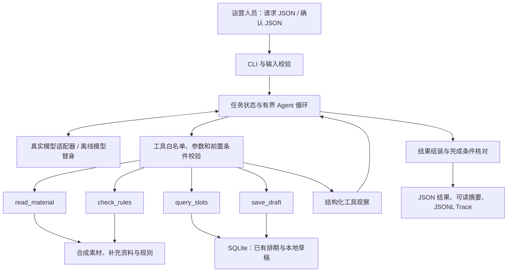

# 项目架构与实施基线

状态：2026-10-30 完成方案定稿；契约与存储后来已有阶段一验证，完整模型循环及业务验收以 [实际阶段记录](16-implementation-progress.md) 为准。本文统一实施选择；项目要求原文见 [原始要求](08-project-requirements-original.md)，业务验收见 [需求矩阵](01-requirements.md)。本文与前期暂定方案不一致时以本文为准。

模块函数、JSON 格式、事务步骤和验收映射已细化至 [开发实现参考](13-implementation-reference.md)。详细开发按该文档执行；其细化约定优先于本文早期概述。

Agent 运行层的提示、请求数据、上下文/记忆、工具接入、循环伪代码、故障处理及实施检查点见 [Agent 开发流程规范](17-agent-development-spec.md)，不改变既有确认、幂等和草稿边界。

## 1. 产品定位与使用者

为内容运营人员处理一组待审核发布单元，输出可确认的排期草稿，以及风险与待办。用户通过 CLI 提交输入 JSON，获取结构化结果和可阅读摘要。
使用体验增补见 [同类产品与用户方案](11-product-experience.md)：首版增加 demo 一键演示和 review 终端交互确认；JSON 作为自动化入口，普通演示不要求手写确认 JSON。以上入口复用同一服务、规则和存储。
审核人员查看风险与依据；运营负责人确认具体替代方案；后续发布人员以草稿作为交接材料。
本项目的审核结论是“按照提供的合成规则检查”的结论，不等同于全面合规认证或发布批准。

### 素材粒度

一个 `material_id` 对应一个发布单元：某版本内容、一个平台、一个账号及其文案、封面等必要字段。同一成片发到不同账号或平台，分别建发布单元，可通过 `source_asset_id` 关联。
首版使用 JSON 合成资料，视频文件只保留引用；文字和已提供的内容摘要可检查。没有读取视频像素、提取音轨或核验版权真实性时，不宣称完成这些审核。
原始图片、拍摄片段的入库管理和成片制作属于上游，本项目处理发布前的成品或待补齐发布单元。

## 2. 确定的技术栈

| 层 | 选择 | 职责与理由 |
| --- | --- | --- |
| 语言 | Python 3.13；本机已检测 3.13.12 | 统一开发与评审环境，类型清楚、便于自动测试 |
| 入口 | 标准库 argparse，CLI | JSON 文件输入，JSON 结果与 Markdown 摘要输出；无需服务部署 |
| Agent | 原生单 Agent、有界工具循环 | 直接展示模型动作、工具观察及下一动作，减少框架学习与隐含行为 |
| 真实模型 | DeepSeek API，默认 `deepseek-flash`，关闭 thinking | 使用原生 tool calls；供应商模型名可配置，实际可用性待真实调用验证 |
| HTTP | HTTPX 0.28 系列，异步客户端 | 直接调用 Chat Completions；配置传输超时和整轮截止时间 |
| 契约 | Pydantic 2 | 校验输入、工具参数和结果；导出工具参数 JSON Schema；禁止意外额外字段 |
| 存储 | 标准库 sqlite3，SQLite 文件 | 事务、唯一约束、跨进程幂等；无需另起数据库 |
| 数据和 Trace | JSON、JSONL、Markdown | 合成资料、程序生成记录、人工阅读交接摘要 |
| 测试 | pytest 8 及以上兼容版本 | 纯业务、工具、受控模型、CLI 和显式 live 评估 |
| 质量 | Ruff | 格式化和必要静态检查，行长 100 |
| 环境与依赖 | venv + pip、pyproject.toml + requirements.lock | 实现时解析并锁定全部精确依赖，然后验证干净安装 |

以上是技术选择，不代表完整模型链路兼容性结论。阶段一已有实际 requirements.lock 与安装记录；干净安装及完整 Agent 验证仍需对应证据。
不引入 Web 前端、HTTP 服务、向量库、Redis、ORM 或多 Agent。业务只有四类工具和小型状态，不需要额外 Runtime 框架。

资料依据：[DeepSeek 接口入口](https://api-docs.deepseek.com/)、[工具调用协议](https://api-docs.deepseek.com/guides/tool_calls/)、[HTTPX 超时](https://www.python-httpx.org/advanced/timeouts/)、[Python 3.13 sqlite3](https://docs.python.org/3.13/library/sqlite3.html)。
模型名使用查阅时的官方示例名，并在每次实际运行元数据中记录请求模型名与服务返回的模型标识；网页聊天账号和 API 凭据不视为同一可用条件。

## 3. 总体架构



循环不是预先写死四个工具顺序。模型选择工具或结束；每次实际结果都回传模型。程序可以拒绝不满足前置条件的动作，再把拒绝原因作为观察返回。
模型选用多个工具时首版按返回顺序串行执行，每个调用单独计数，并避免同轮对同一素材产生互相冲突的写入。

## 4. 模块与职责

```text
src/shadow_agent/
  __main__.py              # CLI 入口
  cli.py                   # demo / review / run / confirm / inspect-draft / seed
  config.py                # 环境、执行预算、存储位置
  contracts.py             # 输入、状态、工具参数与结果类型
  service.py               # 请求编排与独立确认服务
  agent.py                 # 消息历史、模型动作、工具观察、终止
  policy.py                # 工具前置条件与完成条件，不替模型选择业务动作
  result.py                # 根据可信状态输出 JSON 和可读摘要
  trace.py                 # 实时事件与运行元数据
  models/
    base.py                # 模型适配协议
    deepseek.py            # HTTP 请求、tool calls 消息与结果回传
    mock.py                # 显式标记的离线模型替身
    prompts.py             # 任务、边界与工具说明
  tools/
    registry.py            # 四类工具及 Schema
    materials.py           # 素材读取和补查
    rules.py               # 确定性规则检查
    slots.py               # 指定时段与候选查询
    drafts.py              # 保存、复用、修订及校验
  storage.py               # SQLite 事务和唯一约束
tests/{unit,integration,live}/
data/{materials.json,supplements.json,rules.json,schedule.json}
examples/<case>/{input.json,output.json,summary.md,trace.jsonl,run.json}
```

文件在实现时按职责创建；此树为设计，不代表已经存在的业务代码。

## 5. 输入契约

请求包含 `request_id`、1–3 项发布单元 ID、每项发布时间要求及输入版本。批处理逐项运行模型循环，保留每项成功结果，不做整批原子保存。

| 数据 | 必填或处理约定 |
| --- | --- |
| 发布单元 | material_id、material_version、platform、account_id；其他字段由规则指定必填性 |
| 内容 | source_asset_id、媒体引用、正文/字幕摘要、封面引用、版权字段等；缺失保持未知 |
| 时间要求 | 含偏移的 ISO 8601 时间、时区、hard / soft；缺少影响执行的信息则请求补充 |
| 候选范围 | 原时间独立查询；显式候选为离散时间列表，可明确跨日；省略/null 时用请求时区同日 allowed_slots，[] 不回退 |
| 已有排期 | 平台、账号、时间、占用记录 ID、数据版本 |
| 审核规则 | rule_id、版本、字段、条件、severity、说明；仅支持声明过的运算，不执行数据里的代码 |
| 确认输入 | 用户对 draft_id + revision + 明确待确认项的决定，由 CLI 接收，不允许模型代填 |

合成规则示例：版权字段缺失为 needs_info；明确未授权为 blocked；示例禁用表述为 needs_review；必要封面缺失为 needs_info。以上是测试规则，不宣称代表某平台完整政策。
详细实现参考第 4 章的四条规则组成默认合成规则集；默认不要求 license_ref 必填。运行身份与版本字段非法拒绝导入，可缺失业务事实的必填性只由当前导入规则决定。补查只填八个白名单业务字段，不改平台账号或版本，冲突整次不合并。
保留 allowed_slots 名称，含义仅为默认候选集合；原时间和显式候选无需位于其中，显式候选也不与其取交集。所有时间仍检查本地占用；模型不得自行扩大候选范围。

## 6. 四类工具协议

| 工具 | 参数与结果 | 副作用与限制 |
| --- | --- | --- |
| read_material | material_id、detail=basic/supplement；返回字段、版本、来源及缺项 | 只读；补查仍未知则明确返回未知 |
| check_rules | material_id；从可信资料加载并检查，返回 review_status、规则命中、缺项和资料版本 | 只读；不采信模型伪造的“已授权”事实 |
| query_slots | material_id、query=requested/alternatives；平台账号和范围由可信上下文确定，返回占用、候选来源、冲突 ID 和快照版本 | 只读；排除当前草稿自身，不排除同素材其他请求草稿；模型不能添加候选 |
| save_draft | material_id、suggested_at、expected_revision、决策依据的观察引用 | 写入；request_id、原始要求、审核状态、确认状态由可信运行上下文赋值 |

工具统一返回 `ok, code, data, retryable`。预期业务问题返回结构化观察；异常也必须记录。保存成功后再回传真实 ID；没有提交成功的事务不报告成功。

## 7. 决策、前置条件与状态

模型决定：是否补查、查询什么窗口、从有效候选中推荐哪个、何时请求确认或停止。程序负责：字段和规则运算、时间比较、确认绑定、调用预算、写入和去重。
模型通过工具调用执行动作；请求确认或阻断通过最终结构化决策表达。最终 JSON 必须校验；非法结构可在预算内请求模型纠正。不存在 finish 之外的发布动作。

| 维度 | 状态 |
| --- | --- |
| review_status | passed / needs_info / needs_review / blocked |
| confirmation_status | not_required / pending / confirmed / rejected |
| save_status | not_attempted / saved / reused / updated / failed / unknown |
| task_status | completed / needs_input / blocked / incomplete / failed |

passed 仅代表通过本次规则预检。阻断和关键缺项时输出处理结果但不保存可执行时段草稿；软风险允许保存带风险、待确认的草稿。
正常原时段、无风险且无待确认项时可以 completed；替代建议即使保存成功也为 needs_input；预算耗尽为 incomplete。
原时段冲突且本轮候选查询证明为空或全占用时，返回 needs_input、suggested_at=null，请求调整范围；尚未保存时 save_status=not_attempted，此前保存遭到冲突拒绝时保留 failed。查询失败不能当成全占用。已有可保存方案时，模型先保存并消费回执再结束，不能只输出文字请求确认；程序不代为补做业务步骤。
不可继续的保存技术失败使任务 failed，审核和查询成功结果保留；新增占用、过期观察等业务/并发拒绝可以在预算内重新观察调整，不仅凭工具 ok=false 就把任务判为技术失败。提交状态无法确定时 save_status=unknown，不得当作“确定无草稿”。
保存结果无法核实则任务 incomplete。pending_items 区分 input/confirm；缺项与扩大候选范围不可接受为通过，只有软风险和改期可确认。确认状态依据方案要求确认的事项定义及当前有效决定派生：拒绝为 rejected，原本无需确认为 not_required，有未决确认为 pending，全部接受为 confirmed；不能仅因 pending_items 已清空而丢掉 confirmed，也不能把 not_required 当成输入缺项已解决。

原始 hard 要求始终保留；模型可以查找并提出替代，但不能将其写成用户已经接受的新要求。首版所有改变原时段的建议均需用户确认，soft 也不隐含自动改期授权。
确认命令只接受显式列出的可确认项；不能用普通“同意”绕过硬性阻断规则。修改素材、建议时段或规则依据导致方案变更时，确认失效。
同语义有效草稿复用保留当前确认；拒绝仅适用于 active 修订的未决可确认项，拒绝任一项即拒绝方案并释放本地容量，同请求重跑不能恢复 rejected。首版不提供全部已确认或无待确认方案的撤回入口。
本地 CLI 把操作者输入当作用户确认，记录版本与时间；不声称实现真实企业身份验证或权限系统。

## 8. 无冲突与保存语义

首版合成容量规则固定为：同 platform + account_id + 精确离散时段容量为 1；不推断视频时长造成的区间占用。同时间不同账号不算冲突。
时间统一到 UTC 比较，输出保留时区。查询、旧方案核查、保存和确认一致校验已有排期与其他有效草稿的已选建议时段；被阻断、拒绝或失效的草稿不占本地规划容量，排除当前 request_id + material_id 对应的当前草稿自身，同素材在另一请求下的有效草稿仍计入占用。
待确认建议参与本地草稿间的规划冲突检查，但这不是对真实平台的预约。该选择细化了早期“待确认不占正式时段”的约定，避免多个本地草稿建议同一槽位。
query_slots 提供快照，save_draft 在 SQLite 写事务内重新读取版本、检查冲突并写入；确认时再次检查。资料已变则要求重新检查，不能用旧观察保存。
保证范围是所接入的本地资料、排期和草稿快照，不承诺未接入平台或其他系统的全局无冲突。

### 幂等与重新评估

- 唯一键为 `(request_id, material_id)`；建议时段不得作为唯一键的一部分，避免改建议后多建草稿。
- 规范化用户原始输入摘要与请求绑定；相同 ID、不同原始请求返回 INPUT_CONFLICT，补齐空时间字段或改变要求、候选范围均使用新 request_id。新请求独立处理，不自动关联替代或撤销旧草稿，旧有效草稿继续计入占用；首版不提供原始请求就地编辑或自动替换流程。确认操作单独记录，不伪装成修改原请求。
- 更新素材、补充资料、规则或排期后，原始输入未变则使用原请求重评估。候选省略/null 的摘要一致，[] 保持独立语义；items 排序不表达业务优先级，规范化和实际执行均按 material_id 排序。
- 每次 run 都重新观察当前资料和占用；相同请求、同样语义结果复用相同 draft_id，不增加 revision。
- 相同原请求重新评估得到不同方案时，更新同一 draft_id 的 revision，保存历史、失效旧确认；工具写入需匹配 expected_revision，防止覆盖其他运行的修改。
- 方案语义摘要包含用户决定之前的确认事项定义，排除接受/拒绝状态及已过滤的 pending_items，避免仅因完成确认而产生假修订；修订不变时保留有效确认。
- 外部占用新冲突时，应先使旧方案失效并释放旧规划槽位，再产生新方案。若没有可行候选，保留历史但不继续宣称旧草稿有效。
- 修改结果不能通过“已存在”短路而掩盖新冲突；上述规则同时覆盖更换占用时段和重复提交。
- 保存超时先以相同幂等标识核对数据库提交结果，再决定有限重试；未能核实则 unknown。确认只更新当前草稿，不新建另一份。

## 9. 数据存储

合成 JSON 用 seed 命令导入 SQLite；运行期可信数据读同一数据库。规则内容可存 JSON，但规则元数据含版本。
具体结构见 [数据库设计](15-database-design.md)：catalog_meta、materials、supplements、rules、schedule、allowed_slots、catalog_imports、requests、request_items、drafts、draft_history、confirmations、draft_events 共 13 表。完整快照更新当前目录，历史证据和明确用户决定独立保留。drafts 有上述唯一键；当前有效建议时段有对应唯一约束，历史不占用。设计 DDL 检查不等于业务实现或验收。
用 BEGIN IMMEDIATE 保护本地冲突校验和保存；schedule 的修改也必须走同一事务边界。JSON fixture 变更通过显式重新导入更新版本，不自动读取文件变化覆盖运行数据库。
Trace 保存在独立 run 目录；数据库是草稿成功与否的事实来源，Trace 不是事务提交成功的替代证据。

## 10. 执行预算与异常

每个发布单元上限：16 次模型请求尝试、16 次工具调用尝试、总时长 180 秒；一个请求最多 3 项且总时长 540 秒。各项预算独立，整体仍受截止时间约束。
HTTP 连接超时 5 秒、读写超时 30 秒；模型整次请求受 asyncio 截止时间约束，不能把读超时误当总时长。SQLite busy 等待不超过 2 秒。
临时传输错误最多额外重试 1 次；模型重试计入模型预算，工具重试计入工具预算。拒绝或无效调用也计数。不对确定性阻断进行盲目重试。
超限返回 incomplete，包含已完成结果和未完成事项。只记录简短决策依据，不索要或保存模型内部思维过程。

## 11. 必须交付的功能与验证

| 级别 | 功能与完成条件 |
| --- | --- |
| 必须 | CLI 读取请求；合成素材、规则和排期可复现加载 |
| 必须 | 四类工具完整、结构化参数与错误、真实模型消费工具观察 |
| 必须 | 缺项补查、风险处理、冲突后替代建议及明确待确认项 |
| 必须 | 每项五类输出齐全；状态独立且来源可信 |
| 必须 | 跨进程幂等、同标识异内容冲突、保存事务与版本复核 |
| 必须 | 显式确认绑定方案版本；原硬性要求不被擅自替换 |
| 必须 | 明确保存失败；状态未知可核对；保留前面成功结果 |
| 必须 | 调用/时间预算与明确未完成；离线 Mock 无密钥可运行 |
| 必须 | 六个必验场景的真实程序证据，至少两条真实模型决策路径 |
| 必须 | 变更占用后同请求重评估、确认失效和重复提交的组合测试 |
| 必须 | 安装运行说明、锁定依赖、五份文档、AI 使用、真实用时、GitHub URL 与 SHA |
| 暂不实现 | 真实发布、视频理解、素材制作、企业审批权限、人员工时排程、全局最优时间、多 Agent、Web 界面 |

测试划分：unit 测时间和规则；integration 用受控模型替身验证 CLI、循环、数据库和副作用；live 显式启用，验证观察改变后的模型动作。
六个场景是正常、信息不足、规则风险、时段冲突、重复提交、保存失败；正常用例必须使用原时段空闲的条件，与冲突用例分开。
增加确认、版本变化、未知工具、非法参数、总超时、保存前新增占用、同请求变更占用及未知保存结果测试。断言真实 DB 状态和唯一行数，不只看模型文本。
补充验收包括业务字段按规则判缺、默认候选外的显式时间、显式跨日与空候选、自身排除、全占用合法结束、未保存提前结束拒绝、复用保留确认、拒绝后不恢复及新请求不替代旧方案；完整计划断言见开发实现参考第 14 章，当前均未执行。
所有 examples 都由程序实际运行生成；至少保存 input.json、output.json、summary.md、trace.jsonl 和 run.json。run.json 记录模式、代码版本或源码摘要、模型标识、时间和退出码，不含密钥。
真实模型不可用时完成 Mock 与工具验证，但明确标记真实模型决策未验证，不能宣称全部达标。

## 12. 拟定 CLI（尚未实现）

```text
python -m shadow_agent seed --data data --db runtime/agent.db
python -m shadow_agent run --input request.json --mode mock --db runtime/agent.db --output runtime/runs/demo
python -m shadow_agent run --input request.json --mode live --db runtime/agent.db --output runtime/runs/live
python -m shadow_agent confirm --input confirmation.json --db runtime/agent.db
python -m shadow_agent inspect-draft --id D001 --db runtime/agent.db
```

这些是接口设计，不是目前可以执行的业务命令。实现优先级：数据契约与本地工具 → 真实模型最小循环 → 六类场景和幂等确认 → 证据生成与文档核查。
