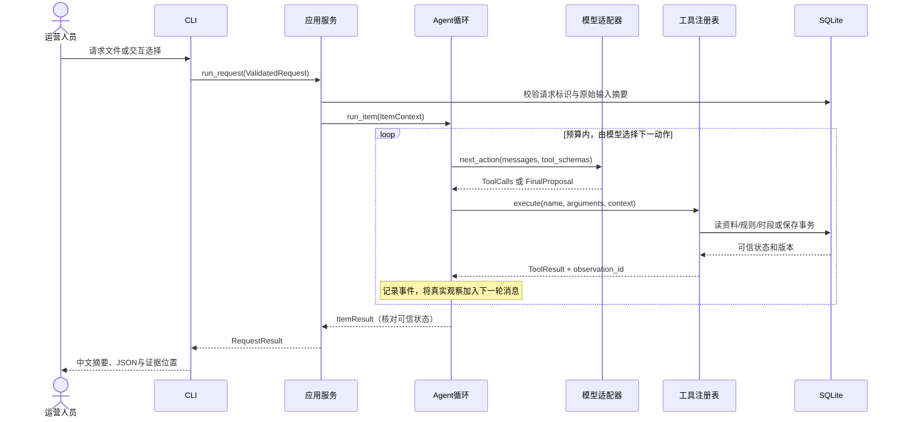

# 开发实现参考 v1.7

当前修订：[发布任务与操作入口](27-task-workflow.md) 覆盖本文历史的发布单元、独立新请求、不能取消等约定。当前同素材/平台/账号唯一任务，要求变化在原任务内生成不可变内部请求；new_publication 不授予再次发布权限；支持 work 与数据库 v2 迁移。其余审核、动态模型决策、保存、确认和预算硬条件继续有效。本文下列设计及示例按其原版本保留，当前结果见第03号文档。

2026-11-01 当前最低完整性、业务时间、跨请求发布意图和失败提议以 [第26号契约](26-review-remediation.md) 为准，取代下文早期对应语义；旧例仅历史设计，不是新执行证据。

2026-10-31 决策信息、动态工具、改期偏好和保存冲突恢复以 [第 24 号契约](24-agent-decision-improvements.md) 为准；默认偏好保持旧请求摘要兼容。外部视频审核尚未接入。

2026-10-31 排期查询调整：以 [一次查询返回排期选项](23-automatic-slot-options.md) 为准。query_slots 不再接受 query 参数；程序在同一读事务检查原时间，冲突时自动检索双向最近合法候选，一次回传给模型推荐。模型不再单独发起 nearest；保存、确认、幂等与身份绑定不变。

2026-10-31 审核有效性补充：审核必须同时匹配当前目录版本和有效素材摘要。重读资料后，只要目录版本或有效摘要变化，就清除旧审核的当前资格；结束校验与公开结果组装再次核对，旧观察仍保留为历史。保存事务的独立复核继续有效。修复记录见 [第 22 号记录](22-defect-fix-results.md)。

2026-10-31 当前变更：模型工具协议与最近节点查找以 [本地身份绑定与双向最近节点](19-local-model-boundary.md) 为准。内部业务 ID/修订/证据留本地，模型只接收业务投影；普通请求无需候选，默认在全部预设节点中找原时间前后各一个最近可用节点，允许跨日。本文未涉及的预算、确认与事务约束继续有效。

状态：业务设计完成；契约与存储已有阶段一实现和离线验证，后续模块完成状态以 [实际阶段记录](16-implementation-progress.md) 为准。本文将已确认的 CLI、技术栈和业务要求落实为模块、接口、数据格式及验收规则。本文是后续开发的详细依据；与早期设计冲突时以本文为准，原始题目要求和用户后续明确指令优先。不得把本文的示例视为实际运行记录。

2026-10-30 v1.1 修订：确定字段与规则的职责、候选范围、自身草稿排除、重评估与原要求变更的区别、确认边界及结束条件。

2026-10-30 v1.2 修订：用户选择完整快照导入与草稿证据快照，细化为 [数据库设计](15-database-design.md) 和 [DDL 设计附件](15-database-schema.sql)。本次仅设计及结构检查，不实现业务代码、类型或工具；第 9 章和关联验收同步细化，业务行为沿用本文。

2026-10-30 v1.3 修订：新增 [Agent 开发流程规范](17-agent-development-spec.md)，细化内部消息/上下文、HTTP 适配、工具配对、结束校验、预算、记忆、故障、分阶段实施与验收。新增运行层设计待实现和验证，不修改现有业务输入、确认、幂等或数据库契约；本次不实现 Agent 功能。

相关材料：[项目要求原文](08-project-requirements-original.md)、[需求与验收](01-requirements.md)、[总体架构](10-architecture-baseline.md)、[运行方式取舍](12-runtime-decision.md)。

## 1. 范围、技术与完成标准

实现 Python 3.13 CLI，原生单 Agent 工具循环，DeepSeek Tool Calls（默认模型沿用架构基线，非 thinking），HTTPX 异步调用，Pydantic 2 数据校验，SQLite 本地事务存储，pytest 和 Ruff。
模型选择已定，但 API 可用性、实际模型效果和依赖补丁版本待实现后验证；不虚构锁文件与通过率。

发布单元是某版本内容在单个平台、单个账号的一次拟发布对象。使用合成 JSON 和媒体引用；审核提供的元数据、文案和规则，不实现视频理解或真实发布。
一次请求 1–3 个发布单元，逐项处理。每项保存独立事务，部分成功不回滚其他项；没有全局最优排期承诺。

必须实现：

| 功能 | 具体完成条件 |
| --- | --- |
| 数据加载 | 素材、补充资料、规则、已有排期可显式导入，版本可识别 |
| 素材读取和补查 | basic/supplement 两类读取，返回来源与缺项，不补造未知 |
| 规则预检 | 输出 passed/needs_info/needs_review/blocked，规则 ID 与证据齐全 |
| 时段查询和建议 | 指定时间与候选查询，冲突后模型选择下一动作 |
| 草稿保存 | 保存前重新核查，返回真实保存结果和可查询 ID |
| 重复提交 | 同一逻辑请求的每素材仅一份草稿；重评估可以修订，不能重复新建 |
| 用户确认 | 接受/拒绝/暂不处理，绑定草稿修订，不能代替用户授权 |
| 失败与执行边界 | 预算、超时、工具错误、保存失败和结果未知清晰返回 |
| 使用入口 | seed/run/confirm/inspect-draft，以及 demo/review 交互包装 |
| 验证和交付 | 六个必验场景、两条真实模型路径、可执行测试与五份交付文档 |

不增加 Web、HTTP API、Notebook、企业账号权限、工时排程、多 Agent、视频生产或真实发布接口。

## 2. 模块如何通信

所有模块在同一 CLI 进程内调用 Python 函数，模块之间使用 Pydantic 对象或明确的结果类型。只有模型适配器对外发送 HTTP JSON。SQLite 是本地状态事实来源，JSONL 是事件记录；两者用途不同。



CLI 不直接访问模型、不执行 SQL、不决定审核通过；工具不调用模型；存储层不生成文案；模型适配器不理解草稿业务。
正常路径可能是读取→检查→查询→保存，但程序不按固定顺序替模型选择这些动作。违反前置条件的动作返回错误观察供模型调整。

## 3. 文件和函数职责

| 文件 | 接口（设计签名） | 职责 |
| --- | --- | --- |
| cli.py | main(argv) -> int | argparse、交互菜单、stdout/stderr、退出码 |
| service.py | async run_request(request, dependencies) -> RequestResult | 请求登记、逐项执行、部分成功、整体结果 |
| service.py | confirm_draft(decision, dependencies) -> ConfirmationResult | 与 review 共用确认服务，不经模型代签 |
| agent.py | async run_item(context, model, registry, trace) -> ItemResult | 消息、预算、动作、观察与退出 |
| models/base.py | async next_action(messages, schemas) -> ModelTurn | 统一 live/mock 接口 |
| models/deepseek.py | DeepSeekModel.next_action(...) | HTTP、工具调用 ID、响应解析与传输错误 |
| models/mock.py | MockModel.next_action(...) | 消费观察的确定性替身，显式标记为 Mock |
| tools/registry.py | execute(name, raw_arguments, context) -> ToolResult | 白名单、Schema、作用域、前置条件、计数 |
| tools/materials.py | read_material(args, context) -> ToolResult | basic 和 supplement |
| tools/rules.py | check_rules(args, context) -> ToolResult | 执行白名单规则，返回证据 |
| tools/slots.py | query_slots(args, context) -> ToolResult | 容量、候选和冲突来源 |
| tools/drafts.py | save_draft(args, context) -> ToolResult | 事务保存、复用、修订、保存后核对 |
| policy.py | validate_action / validate_finish | 检查前置条件与结束条件，不替模型选择下一工具 |
| storage.py | Repository + transaction context | 参数化 SQL、版本、唯一约束、查询和持久化 |
| result.py | assemble_result / render_summary | 根据可信状态输出固定格式；不直接采用模型的成功声明 |
| trace.py | emit(event) / write_run_metadata | 脱敏事件、观测引用、运行元数据 |
| contracts.py | 请求、观察、结果和枚举 | 一处定义模型和工具契约 |

dependencies 显式注入配置、Repository、Model、Clock、TraceSink；不以全局变量保存业务状态。先实现具体需求，不创建通用插件或工作流框架。

## 4. 请求与资料格式

所有 JSON UTF-8；请求、确认和运行结果带 schema_version="1.0"，fixture 数组和目录对象按下文格式导入，Trace 事件也带版本。ID 非空，时间必须带 UTC 偏移，未知业务事实用 null；未知字段报错。格式错误与业务信息不足分开：非法 JSON/时间格式拒绝执行；合法但缺必要业务事实的输入返回 needs_input。
记录中文文本，代码字段与枚举用英文。实际类型定义在 contracts.py，工具 Schema 从同一模型导出，避免重复维护。

### 4.1 用户请求 Request

```json
{
  "schema_version": "1.0",
  "request_id": "REQ-20261103-001",
  "items": [
    {
      "material_id": "M01",
      "publish_requirement": {
        "requested_at": "2026-11-03T18:00:00+08:00",
        "timezone": "Asia/Shanghai",
        "constraint": "hard"
      }
    }
  ]
}
```

platform/account_id/version 从可信素材读取，不让用户请求和模型各填一套相互矛盾的值。requested_at、timezone、constraint 允许 null 以覆盖信息不足，影响执行时必须澄清；非空值必须合法并一致。首版要求偏移与 IANA 时区匹配，环境缺时区数据时安装 tzdata 并锁定版本。
上述三项任一未知时，不猜测日期、时区或 hard/soft，不查询时段或保存草稿；模型仍可读取素材和检查规则，结束时列出具体缺项。constraint 的合法非空值为 hard/soft；两者都不授权自动改期。

时间范围按下表唯一解释，不以默认候选集合限制用户明确指定的时间：

| 输入 | 查询与保存边界 |
| --- | --- |
| requested_at | 原始要求，requested 查询只检查此时刻；即使不在 allowed_slots 或 candidate_times 内也可查询，观察为可用后可保存 |
| candidate_times 为非空列表 | 兼容的显式范围限制；按 UTC 去重，只返回其中原时间前后各一个最近可用节点，无需与 allowed_slots 取交集 |
| candidate_times 省略或为 null | 普通入口使用该平台、账号的全部已配置 allowed_slots，在原时间前后各找一个最近可用节点，允许跨日，不只向后找 |
| candidate_times 为 [] | 用户未提供替代空间，alternatives 返回空候选，不回退到 allowed_slots；原要求仍可查询和保存 |

candidate_times 仅允许查询和建议，不代表已经接受改期。所有非空时间均需合法且偏移与请求 timezone 在该日期的偏移一致，跨日候选也按各自日期校验。模型不能通过工具参数添加候选；没有替代空间或候选全部占用时，明确请求用户调整要求或候选范围。所有偏离原时刻的建议，无论 hard/soft、是否来自用户候选，都产生 change_time 待确认项；同一 UTC 时刻的不同表示不算改期。
mode、db、output、模型配置属于 CLI/运行配置，不参与原始业务请求摘要。items 不得重复 material_id。

### 4.2 素材 materials.json（数组）

```json
[
  {
    "material_id": "M01",
    "material_version": 2,
    "source_asset_id": "VIDEO-001",
    "title": "新品功能介绍",
    "type": "video",
    "platform": "douyin",
    "account_id": "brand_main",
    "media_ref": "synthetic://video/M01-v2.mp4",
    "caption": "支持字幕功能",
    "cover_ref": "synthetic://cover/M01-v2.jpg",
    "copyright_status": null,
    "license_ref": null
  }
]
```

synthetic:// 仅用于表示虚构资产，不自动下载或宣称真实文件存在。项目验证的是该元数据的业务流程。

字段分为运行身份与可缺失业务事实，必填性不从 JSON 示例推断：

| 字段 | 类型及校验 | 缺失处理与补查权限 |
| --- | --- | --- |
| material_id、platform、account_id | 非空字符串 | seed 缺失、null 或空白即格式错误；supplement 不得修改 |
| material_version | 正整数 | seed 缺失或非法即格式错误；supplement 不得修改 |
| source_asset_id、title、media_ref、caption、cover_ref、license_ref | 字符串或 null | 可省略并规范化为 null；空白文本按未知处理；允许补查 |
| type | video/image/text 或 null | 可省略并规范化为 null；非法非空值拒绝导入；允许补查 |
| copyright_status | authorized/unauthorized 或 null | 可省略并规范化为 null；未知用 null，其他非空状态拒绝导入；允许补查 |

业务字段未知不等于整个文件格式错误；是否造成 needs_info 由当前导入规则决定。保存校验运行身份、明确的原时间要求和规则结论，不再另藏一份业务必填清单。例如 license_ref=null 本身不禁止保存；仅在导入的规则明确要求它时返回缺项。规则检查没有执行成功时仍不能报告 passed。

supplements.json 存可补查字段和来源：

```json
[
  {
    "material_id": "M01",
    "supplement_version": 1,
    "fields": {"copyright_status": "authorized", "license_ref": "LIC-001"},
    "source_id": "SYNTHETIC-LICENSE-REGISTER"
  }
]
```

Agent 先 read_material basic，仅获得基本资料；选择 supplement 后才能把补充事实纳入本次有效素材快照。补查白名单仅为上表允许补查的八个字段，不含身份、平台账号或版本。fields 中的值沿用素材字段类型，supplement_version 为正整数、source_id 为非空来源标识；非法配置在 seed 时拒绝。
补充只填补未知值；与已知值相同则保留原值与来源，与已知值冲突返回 DATA_CONFLICT，本次不合并任何补充字段，不静默覆盖。模型不能通过工具参数提交自己编造的元数据。basic 返回各业务字段的来源引用，supplement 返回已补齐、仍未知和冲突项，规则命中引用实际被使用的字段来源。

### 4.3 规则 rules.json（数组）

```json
[
  {
    "rule_id": "R-COPYRIGHT-MISSING",
    "version": 1,
    "field": "copyright_status",
    "operator": "missing",
    "value": null,
    "severity": "needs_info",
    "message": "缺少版权状态，请补查授权资料"
  },
  {
    "rule_id": "R-COPYRIGHT-DENIED",
    "version": 1,
    "field": "copyright_status",
    "operator": "equals",
    "value": "unauthorized",
    "severity": "blocked",
    "message": "未授权素材不得进入排期"
  },
  {
    "rule_id": "R-COVER-MISSING",
    "version": 1,
    "field": "cover_ref",
    "operator": "missing",
    "value": null,
    "severity": "needs_info",
    "message": "示例业务规则要求提供封面引用"
  },
  {
    "rule_id": "R-CAPTION-REVIEW",
    "version": 1,
    "field": "caption",
    "operator": "contains",
    "value": "最强",
    "severity": "needs_review",
    "message": "示例品牌规则要求人工核实该表述依据"
  }
]
```

首版只实现 missing/equals/contains；字段和运算符白名单，不执行 eval。missing 包括 null、空白文本；未知状态字符串视为字段校验错误，不能视为已授权。匹配规则合并：blocked > needs_info > needs_review > passed。未知规则、错误字段和非法配置在 seed 时拒绝，不降级为通过。示例不是法律或平台政策结论。

上面的四条规则组成首版随项目交付的默认合成规则集，阶段一已提供 data/rules.json；演示和验收 fixture 按此落实。示例不代表实际 Agent 运行。默认规则不要求 license_ref 必填；若业务确需该字段，可显式导入对应 missing 规则并重新评估，不能由模型临时增加。
规则 field 白名单与上表八个可补查业务字段一致；rule_id 为非空标识，允许新增符合契约的规则 ID，不把示例 ID 当作封闭白名单。“未知规则”指不支持的规则结构或运算，不指新增 ID。missing 的 value 必须为 null；equals 的 value 必须是对应字段的合法非空值；contains 仅用于自由文本字段，value 必须为非空文本，按字面大小写敏感匹配；equals/contains 遇到未知字段值不命中，需要 missing 规则表达该字段必需性。severity 仅允许 needs_info/needs_review/blocked，version 为正整数。
seed 校验整个规则集，拒绝空规则集、重复 ID、错误字段或非法类型；显式导入的有效非空规则集是该版本的审核依据，程序不偷偷补上另一套规则。只有实际成功执行该规则集且无规则命中，才派生 passed。

### 4.4 排期 schedule.json

```json
{
  "schedule_version": 1,
  "allowed_slots": [
    {"platform": "douyin", "account_id": "brand_main", "at": "2026-11-03T18:00:00+08:00"},
    {"platform": "douyin", "account_id": "brand_main", "at": "2026-11-03T19:00:00+08:00"}
  ],
  "entries": [
    {"entry_id": "S01", "platform": "douyin", "account_id": "brand_main", "at": "2026-11-03T18:00:00+08:00", "material_id": "M00"}
  ]
}
```

只检查同平台、同账号、同一个精确离散时刻；不把视频播放时长当成发布时间区间。不同时区的同一时刻按 UTC 判等；查询结果列明冲突来自 schedule 还是 draft。
保留字段名 allowed_slots，其唯一含义是默认候选集合，不是所有可发布时间的白名单；没有对应默认候选时，原要求和显式候选仍可按第 4.1 节检查。没有接入的时段禁发规则不自行推断。
requested、alternatives 查询、旧方案核查、保存和确认采用相同冲突范围：排除当前 request_id + material_id 对应的当前草稿自身，计入 schedule 和其他 active 草稿。不能按 material_id 排除所有草稿；同素材在另一请求下的有效草稿仍算其他占用。stale/rejected 草稿和历史修订不占容量。

## 5. 运行上下文和事实传递

字段生命周期、模型可见投影、消息配对和跨进程恢复边界进一步遵循 [Agent 开发流程规范第 6–10、16 章](17-agent-development-spec.md#6-itemcontext事实来源与失效规则)。

ItemContext 由程序持有，至少包含 run_id、request_id、当前 material_id、不可变原要求、预算/截止时间、observations 映射、已读取有效素材、最新规则检查、候选查询、保存尝试和已有草稿修订。
起始模型消息只提供当前项原时间要求、已有方案的业务时间/有效性/确认摘要；request_id、material_id、draft_id、revision、观察和来源标识不进入模型业务消息。程序本地记录每次模型请求依据的修订，保存时注入；冲突后刷新业务投影供模型重新判断，不能猜测或自动覆盖。已有状态不代替本轮素材、规则和时段观察。
模型只在当前素材范围内调用工具；请求范围外的素材 ID、伪造观察引用或其他用户确认被拒绝。全部模型文字与素材文本视为不可信数据，不能直接更新 context 的事实字段。

采用一个保守的 catalog_revision：资料、规则或已有排期实际变化时递增；同内容重新 seed 不递增。观察与草稿记录该版本和有效素材摘要。任何资料版本变化都要求刷新相关检查，可能造成额外复查，但能减少首版版本判断复杂度。
其他草稿变化不必让所有审核失效；时段在保存事务内重新检查。SQLite 存业务资料，只有本轮真实工具返回才能成为模型的已观察事实。

## 6. 工具参数和返回格式

所有工具参数可有 reason_summary 字段，存放简短动作依据，不包含内部思维过程。核心业务参数如下：

| 工具 | 参数 | 前置条件 |
| --- | --- | --- |
| read_material | detail: basic/supplement | 程序绑定当前素材；supplement 需先读取 basic |
| check_rules | 无核心业务参数 | 至少读取 basic；检查本轮有效快照 |
| query_slots | 无核心业务参数 | 至少读取 basic；原要求明确；同一读事务返回原时间状态，冲突时附带双向最近候选 |
| save_draft | suggested_at | 程序注入已回传审核/时段观察及本轮绑定修订；最新检查允许，原要求明确、时刻合法可用且方案未 rejected |

查候选只在第 4.1 节确定的集合内；用户显式列出的跨日候选可查，模型不能自行添加账号、日期或时刻。save_draft 不接受 review_status、confirmation_status、request_id、draft_id 这些由程序决定的字段。

以下为仅留本地和 Trace 的 ToolResult 示例；不能原样发给模型。模型观察采用白名单业务投影，当前聚合结构详见第 23 号规范；以下历史简化片段不代表 v3 完整 Schema：

```json
{
  "observation_id": "OBS-004",
  "tool": "query_slots",
  "ok": true,
  "code": "SLOT_CONFLICT",
  "retryable": false,
  "catalog_revision": 7,
  "data": {
    "requested_at": "2026-11-03T18:00:00+08:00",
    "available": false,
    "conflicts": [{"source": "schedule", "id": "S01"}],
    "candidates": []
  }
}
```

时段占用是成功查询到的业务事实，故 ok=true；未知工具、错误参数、保存冲突等动作未完成为 ok=false。工具实际异常也转换成错误观察并记录。不能把失败返回包装为空成功结果。
query_slots 一次返回原时段与必要的替代候选。原时间可用时不检索替代；冲突时在同一读事务内，从合法节点查找前后各一最近可用节点。内部子观察沿用 requested/alternatives 标签，checked_slots 记录实际检查的占用，模型投影不含占用记录 ID。空候选也是成功查询，不伪装成工具失败。原时刻不进入替代结果；当前草稿自身排除由本地上下文确定。
规则命中包含 rule_id、severity、field、observed_value、source_id、message；工具返回不把媒体文件、密钥或无限长文本送进模型。

## 7. 模型循环和结束协议

可直接参照的控制流、纠错上限和完成核对见 [Agent 开发流程规范第 13–15 章](17-agent-development-spec.md#13-循环实现算法与控制流约束)。预算上限不授权增加模型或工具调用；新增运行层限制均需实际测试后才可声明完成。

模型适配器输出 ModelTurn，其一为工具调用列表（保留提供方 call_id），其二为经过校验的 FinalProposal。
工具调用的 assistant 消息与每个 role=tool、tool_call_id 对应结果必须正确加入历史。多个调用串行执行；每个均校验当前状态，预算不足的未执行项也获得明确拒绝观察，不伪造执行。
Schema 以 Pydantic 定义为准，非法参数与无效结束可在预算内纠正。无效调用和纠正请求照常计数。

FinalProposal 只请求 finish/needs_input/block，并提交简短说明和观察引用；模型不直接决定保存结果或用户确认事实：

```json
{
  "action": "needs_input",
  "reason_summary": "原时段已占用，已找到最近可用时段，需要用户确认"
}
```

程序从可信状态派生最终待确认项和结果。若模型试图在未核查规则/未保存时声称 completed，拒绝该结束并返回缺少哪些步骤；不得直接替模型偷偷完成业务链路。
资料不足、明确阻断或预算耗尽时可结束且保存未尝试。预算耗尽由程序强制停止，不再调用模型请求最后总结。
正常已保存后仍至少给模型一次消费保存结果并结束的机会；最后一轮没有预算则如实 incomplete，保留真实保存结果。
失败保存后模型可以在 retryable 且有预算时重试，否则结束。确定性的业务阻断不自动重试。

validate_finish 按可信状态校验结束，不仅检查模型 action 字符串：

| 已有事实 | 合法结束与必须输出 |
| --- | --- |
| 原时间、时区或 constraint 未知，或规则检查得到 needs_info 且仍有缺项 | needs_input；列出字段及补充位置，不保存新方案；已有工具与补查结果保留 |
| 规则检查得到 blocked | block，结果 blocked；列出规则和事实，不保存新方案，不提供“接受阻断”选项 |
| 原时段冲突，且本轮 alternatives 已证明合法候选为空或全部占用 | needs_input；suggested_at=null，待办为调整原要求或候选范围；尚未调用保存时 save_status=not_attempted，已调用则保留真实操作状态，不伪造草稿 |
| 规则允许、时间要求明确，已观察到可用原时段或候选 | 先由模型调用 save_draft 并消费保存观察；无未决项则 finish/completed，有改期或软风险待确认则 needs_input |
| 保存发生技术失败且模型选择停止，或保存结果仍无法核实 | 可 finish，分别派生 failed 或 incomplete；保留 failed/unknown 保存状态及此前成功检查，不包装为业务待确认 |
| 当前逻辑键已有 rejected 草稿 | 不得保存或自动恢复；可 needs_input，列出需用户以新 request_id 发起独立请求，不提供重新接受旧修订的选项 |

资料缺失时可先补查再结束，也可基于真实缺项请求用户补充，不强迫固定工具顺序；B02 的补查分支仍需真实验证。原时段冲突而尚未查询 alternatives 时，不能无依据断言“没有可用时段”；候选全占用必须有本轮查询证据。查询失败不能当成全占用，按错误及预算规则处理。
找到可保存方案时，仅输出“请用户确认”而没有保存的结束请求无效；程序返回缺少步骤供模型纠正，不代为保存。以上常规结束仍受技术错误和预算优先级约束，预算耗尽强制 incomplete。
保存时发现新增占用的 SLOT_CONFLICT、过期观察或修订冲突属于业务/并发拒绝，不自动等同于不可继续的技术失败。模型可在预算内刷新观察并调整；最终证据证明无可用时段则可 needs_input。实际调用 save_draft 且被明确拒绝或失败时，本次 save_status=failed，不能为配合结束状态改成 not_attempted；后来成功保存则按最后核实结果报告，并在 Trace 保留前次失败。unknown 未核实前不得作为“无草稿”结束。

## 8. 输出格式与状态

结果示例（设计数据）：

```json
{
  "schema_version": "1.0",
  "run_id": "RUN-DEMO-001",
  "request_id": "REQ-20261103-001",
  "mode": "mock",
  "task_status": "needs_input",
  "items": [
    {
      "material_id": "M01",
      "material_version": 2,
      "review_status": "passed",
      "risk_reasons": [],
      "original_requested_at": "2026-11-03T18:00:00+08:00",
      "constraint": "hard",
      "suggested_at": "2026-11-03T19:00:00+08:00",
      "confirmation_status": "pending",
      "pending_items": [
        {"id": "change_time", "kind": "confirm", "message": "是否接受 19:00 替代原要求 18:00？"}
      ],
      "draft": {"id": "D001", "revision": 1, "validity": "active", "save_status": "saved", "error": null},
      "task_status": "needs_input",
      "evidence_ids": ["OBS-003", "OBS-004", "OBS-005", "OBS-006"]
    }
  ]
}
```

字段必须保留，未知值用 null；没有审核成功时 review_status=null，并附未完成原因，不能伪造 passed。
save_status 是本次操作结果，draft.validity 是持久化对象状态，两者分开。例如更新失败可能仍有历史 draft_id，但旧方案已 stale，不能展示为本次保存成功。

| 维度 | 枚举与派生规则 |
| --- | --- |
| review_status | null / passed / needs_info / needs_review / blocked；由规则工具派生 |
| confirmation_status | not_required / pending / confirmed / rejected；由明确待办和当前有效用户决策派生 |
| draft.validity | null / active / stale / rejected；active 只表示当前本地方案有效，不代表已经批准或发布 |
| save_status | not_attempted / saved / reused / updated / failed / unknown；由存储动作核实 |
| task_status | completed / needs_input / blocked / incomplete / failed |

pending_items 从缺项、可裁量风险、时间变化、无可用时段或已拒绝方案产生。kind 为 input/confirm；缺项使用 missing:<field>，无可用时段使用 schedule:expand_range，已拒绝后重跑使用 request:new_request，均为 input；风险 risk:<rule_id> 和 change_time 为 confirm。只有 confirm 项可被 accept/reject，补资料或扩大范围不能用一次“同意”代替。
confirmation_status 按方案要求确认的事项定义及当前有效决定派生：当前草稿被拒绝时 rejected；方案原本无需任何可确认事项时 not_required，即使仍有 input 项；需要确认且尚有未决项时 pending，全部被当前有效决定接受后 confirmed。不能因为已接受事项从 pending_items 移除，就把 confirmed 改成 not_required。没有时段时没有 change_time 项，不能展示成“接受一个尚不存在的建议”。
单项终态优先级：不可继续的技术错误 failed；预算或协议未完成 incomplete；明确规则阻断 blocked；缺项或待确认 needs_input；有效草稿已保存/复用且无未决事项才 completed。
无可用时段和已拒绝后需新请求也归 needs_input。提交结果无法核实属于 incomplete，保存发生不可继续的技术失败且停止属于 failed；同一运行中重试后核实保存成功，则按最终核实状态派生，不因已恢复的错误永久标 failed。当前 suggested_at 只呈现有效方案；旧 stale/rejected 草稿仅保留 ID、修订、validity 和历史，不能作为当前建议。其 save_status 仍描述本次动作，例如未尝试保存即 not_attempted。
批任务的 task_status 按 failed > incomplete > blocked > needs_input > completed 聚合，必须保留所有 items 独立结果。确认过的有效软风险可保持 review_status=needs_review，同时 pending 已解决、任务 completed；不把人工接受风险改写成原规则 passed。
summary.md 使用固定中文模板按这些字段渲染，避免模型自由文案虚报“已发布”。stdout 返回结果 JSON，交互摘要与进度走 stderr；review 是专用交互入口。

## 9. SQLite 结构和事务

| 表 | 关键字段及约束 |
| --- | --- |
| catalog_imports | 导入主键、前后目录版本、applied/noop、文件摘要/数量、变更摘要；不归档完整目录 |
| catalog_meta | 单行 revision、当前 applied 导入引用、合成源数据摘要与 schedule_version |
| materials | material_id 主键、material_version、平台账号、八个可空业务字段、is_current、内容摘要和导入来源 |
| supplements | material_id 主键/外键、supplement_version、来源、fields_json、is_current 与内容摘要 |
| rules | rule_id 主键、version、字段/运算/值/风险/说明、is_current 与内容摘要 |
| schedule | entry_id 主键、platform、account_id、at_utc 三者唯一；素材为外部引用，不要求本地存在 |
| allowed_slots | platform、account_id、at_utc 联合主键，仅表示当前默认候选 |
| requests | request_id 主键、首次原始表达、canonical_input_json、input_sha256；不可变 |
| request_items | request_id + material_id 联合主键，原时间/时区/constraint 与可空候选数组；不强制素材已存在 |
| drafts | 稳定 draft_id、逻辑唯一键、当前修订/有效性/建议时刻与摘要；当前指针延迟外键到 history |
| draft_history | draft_id + revision 联合主键、内部 storage_write_id 唯一、实际资料/规则/时段与确认定义的不可变快照 |
| confirmations | operation_id 主键、具体修订外键、完整规范输入/摘要、实际决定、原回执与入口/时间 |
| draft_events | 草稿修订外键、创建/修订/失效/接受/拒绝、原因、导入或确认引用；仅追加 |

drafts 上 UNIQUE(request_id, material_id)。已保存方案 at_utc 非空，有效时段用部分唯一索引 UNIQUE(platform, account_id, at_utc) WHERE validity='active'。此索引只约束草稿；与 schedule 的交叉冲突必须在事务中检查。stale/rejected 的旧时刻仅供审计，输出仍不显示为当前建议。payload 统一存 history，drafts 不再重复保存另一份 JSON。
所有 SQL 使用参数绑定，所有业务写入通过同一 Repository。事务显式 BEGIN IMMEDIATE / COMMIT / ROLLBACK，busy 等待不超过 2 秒；不在数据库事务中等待模型或网络。
seed 默认仅初始化空库；更新资料需要显式 --update。四个文件组成单一完整目录，缺文件失败、明确空排期合法、空规则非法。实际变化以一个事务更新资料、递增 catalog_revision，保留请求和全部草稿历史；首版保守地将所有基于旧目录的 active 草稿标 stale 并记原因，释放本地规划容量。rejected 不改状态，缺席素材/补充/规则停用，旧排期/默认候选替换。相同规范内容只记 noop，不增版本、不失效。不得静默清库；demo 使用隔离路径。

详细字段、主外键、索引、连接、写事务、迁移与恢复见 [数据库设计](15-database-design.md)。业务目录版本不同于 PRAGMA user_version。数据库外键每连接显式开启；真正草稿必须引用合法请求项及已知素材。所有入库时间统一为固定六位微秒 UTC TEXT，超出可无损表达精度的输入拒绝，不能静默截断。

## 10. 幂等、旧方案与保存步骤

### 请求登记

canonical 输入排除 run_id、mode、路径等运行字段，items 按 material_id 排序、候选时间按 UTC 去重排序、JSON 排序键序列化，再计算 SHA-256。
candidate_times 省略与 null 规范化为同一默认范围，[] 保持独立语义；时间按同一 UTC 表示参与摘要，timezone 和 constraint 保留。输入 items 的排列不表达优先级，执行也按 material_id 排序，以免同一摘要因输入顺序不同而改变抢槽顺序；不承诺批次最优。
同 request_id 且摘要不同返回 INPUT_CONFLICT；相同摘要每次都重评估当前资料。幂等是同请求一份草稿，不是跳过观察。

### 重评估、补资料与改变原要求

| 用户操作 | 首版处理 |
| --- | --- |
| 修改素材、补充资料、审核规则或已有排期 | seed --update 显式导入后，原始请求未变则使用同 request_id 重评估；补资料不通过确认接口写入 |
| 补齐原请求中的 null 时间/时区/constraint，或改变原时间、hard/soft、候选范围、素材集合 | 原始请求已变，使用新 request_id；同 ID 提交仍为 INPUT_CONFLICT |
| 接受具体替代时间或软风险 | 使用 confirm/review 决定当前草稿的明确待确认项，原请求及其摘要保持不变 |
| 使用新 request_id 提交同素材 | 独立请求，不自动撤销、修改或关联替代旧草稿；旧有效草稿作为其他占用正常计入 |

首版不提供原始请求就地编辑、自动替换旧请求、已确认方案撤回或通用草稿取消入口。新 ID 不能被描述为“已替换旧方案”。若旧方案仍有待确认项，用户可按第 11 章明确拒绝该方案后另建请求；没有待确认项或已经确认的有效草稿不属于此拒绝入口的适用对象。这一限制在 review 和 README 中明示，不通过改库或制造版本变化模拟用户撤回。
rejected 是当前逻辑请求的终止决定；同 request_id 重跑仍可产生新的读取与审核观察，但 save_draft 返回 DRAFT_REJECTED，不增修订、不恢复容量、不清除拒绝记录，结束为 needs_input 并提示新请求。资料或排期更新不得把 rejected 改成可自动激活的 stale。

### 保存事务

1. 核对请求身份、当前草稿 revision（新建为 0）、观察归属和引用真实性。
2. 程序绑定本轮已回传的审核/时段依据和修订，核对 catalog_revision 与真实快照；不一致返回 STALE_EVIDENCE，模型需重新读取和检查。模型不填写内部引用。
3. 核查最新规则状态、运行身份字段、明确的原时间要求、已观察可用的原时刻或合法候选、账号。业务必填性只由导入规则产生；阻断或关键缺项返回 PRECONDITION_FAILED，已拒绝方案返回 DRAFT_REJECTED。
4. 在同一写事务内检查 schedule 和其他 active drafts，排除当前 draft_id；发现冲突返回 SLOT_CONFLICT，不落库新方案。
5. 比较语义摘要：material_version、有效资料摘要、完整适用规则定义/版本及命中、原要求、建议时段和方案要求确认的事项定义。事项定义按用户决定之前的方案计算，不使用已过滤掉接受项的 pending_items；用户接受本身不改变方案语义。排除措辞、观察 ID、时间戳、模型说明和用户决定状态，避免随机文案或确认操作导致假修订。
6. 已有 active 草稿与版本/证据都相同则 reused，不增修订、不清除有效确认；否则更新同一 draft_id、revision+1，记录历史并失效旧确认；新建从 revision=1 开始。
7. COMMIT 后返回 saved/updated/reused 及 ID；事务异常且已知回滚时返回 failed。新建/修订将程序生成的 storage_write_id 与 history 同事务写入；提交结果不明时用独立连接按写入凭据、逻辑键、预期修订与语义摘要核对，另查当前有效性。仅有同语义行不能证明本次写入发生；仍无法确定则 unknown，不盲重试。

已有草稿重新评估时，应用服务先验证旧快照和占用：旧方案不再成立则用短事务标 stale 并记录原因；这是事实维护，不为模型选择替代方案。如果资料未变且旧方案有效，保持有效，不因启动 run 而释放其槽位。
旧方案有效、新建议保存失败时保留旧方案但报告本次失败；旧方案已经 stale 时不得把旧 ID 当成当前有效保存成功。新方案与失效方案语义相同时仍需重新校验并以新修订激活，不能直接 reused。
expected_revision 不匹配返回 REVISION_CONFLICT，避免并发覆盖。首版 CLI 执行状态正常时足够用；不承诺取消任意系统级阻塞或跨多个数据库的原子性。

## 11. 用户确认与 review

```json
{
  "schema_version": "1.0",
  "operation_id": "CONFIRM-001",
  "draft_id": "D001",
  "expected_revision": 1,
  "decisions": [{"item_id": "change_time", "decision": "accept"}]
}
```

confirm 服务先在事务内检查 operation_id 重放：同样完整规范内容复用原回执，不同内容拒绝；重放不重新执行决定，并另行展示当前草稿状态。首次操作再检查当前修订、有效性、资料版本、规则和时段，接受明确的待确认项。
accept 只解决当前列出的可确认项；blocked 和 missing 项不允许接受为通过。所有可确认项接受后 confirmation_status=confirmed，尚有未决可确认项则为 pending。reject 使方案 rejected、释放本地规划槽位；skip 不写入。
accept/reject 仅适用于当前 active 修订中尚未解决的 kind=confirm 项；一个可确认项被 reject 即拒绝整份方案，不表示只删除该风险或取消该待办。全部已确认、无待确认项、stale 或 rejected 的草稿不能借此入口撤回或重新批准。
同次输入每个 item_id 只允许一个决定，重复项、未知项、input 项或同时包含 accept 与 reject 时整体拒绝且不部分写入；可只接受部分待确认项，其余保持 pending。全部 skip 不写操作记录、确认或状态变化；包含 accept 和 skip 时仅记录实际接受项，skip 不形成确认事实。operation_id 的已写入请求按完整规范化输入核对重放，不能借同 ID 改决定。
确认不修改方案内容 revision，而写独立审批记录；方案后来变化时这些记录保留历史，但不再作为当前确认依据。
同语义有效草稿重跑并 reused 时，保留对当前修订的有效接受记录；不能重新生成 change_time/risk 待办使用户重复确认。方案修订后，旧记录只作为历史，不再消除新修订的待办。
review 展示精确标题、平台账号、日期时区、风险、原要求和建议，提供数字菜单；默认 skip，不从自然语言猜测用户同意。用户确认服务不调用模型。

## 12. 限制、故障和 CLI 契约

沿用架构基线：每项 16 次模型尝试、16 次工具尝试、180 秒；最多 3 项、总共 540 秒。连接 5 秒、读写 30 秒、整次模型调用 deadline 为 min(剩余预算, 30 秒)。临时错误最多额外重试 1 次，重试计数。
模型请求重试只重发未执行工具的模型请求，不重放上一轮保存；工具保存失败后的再次尝试用相同逻辑键。预算在任何副作用之前检查。
故障注入只在测试或显式 demo 场景中启用，不能让模型触发任意故障。支持素材读取错误、查询错误、保存前失败、提交后回执丢失、仅首次失败等明确类型。

| CLI | 行为 |
| --- | --- |
| seed --data data --db PATH [--update] | 校验全部 fixture 后事务导入，失败不部分更新 |
| run --input FILE --mode mock/live --db PATH --output DIR | 执行，生成真实结果和证据，输出目录不得覆盖已有运行 |
| confirm --input FILE --db PATH | 结构化确认，返回真实决策结果 |
| inspect-draft --id ID --db PATH | 当前草稿、修订和历史状态，不以旧报告代替当前状态 |
| demo [--mode mock/live] | 默认 Mock，使用独立数据目录和稳定请求，重复运行可观察幂等 |
| review --db PATH | 数字菜单，调用同一 confirm 服务 |

上表是 CLI 契约，实际入口完成与验证情况以阶段记录为准，不能因有命令设计就声明已经可运行。退出码：0=completed 或成功查询，2=输入/配置错误，3=needs_input，4=blocked，5=incomplete，1=failed。演示说明包含非零业务状态的含义，不能把待确认误当崩溃。参数显式给 mode；demo 默认 mock；Mock 不需要密钥。
进度和说明走 stderr，机器结果走 stdout。输出目录生成 input.json、output.json、summary.md、trace.jsonl、run.json；没有伪造运行日志的静态填充步骤。

## 13. Trace 和证据契约

JSONL 一事件一行，共同字段：schema_version、run_id、event_id、material_id、step、timestamp（UTC ISO）、mode、event_type、elapsed_ms、budget_remaining。
事件类型：model_action、tool_result、final、error、state_change。模型动作保留 tool_call_id、工具和脱敏参数、简短依据；tool_result 保留 observation_id、返回摘要和资料版本。观察与下一动作可通过调用历史和步骤关联。
不保存 reasoning_content 或要求内部思维过程；原始响应仅保留必要工具动作和可公开解释字段。生成摘要不替代工具实际返回的可信状态。
run.json 记录开始结束、命令的非敏感参数、源码 commit 或内容摘要、模型请求及返回标识、配置预算、退出码和输出文件清单。无密钥或私密真实资料。
资料、模型或工具不可用时如实产生错误证据；Mock 与 live 文件明确区分。

## 14. 验收、实现顺序与设计理由

逐阶段产出、检查和提交顺序，以及六个必验场景的精确夹具/断言见 [Agent 开发流程规范第 19–22 章](17-agent-development-spec.md#21-可以逐项执行的开发阶段与退出条件)。本章业务验收不能由文档静态检查替代。

| 用例 | 必须验证的行为 | 主要层 |
| --- | --- | --- |
| B01 正常 | 原时间可用，规则 passed，数据库真实保存，completed | 工具/集成/live |
| B02 缺资料 | 模型补查；补齐后继续，补不到则 needs_input，不伪造事实 | 循环/规则/live |
| B03 风险 | needs_review 与 blocked 不混淆；阻断无法被普通确认绕过 | 规则/策略/确认 |
| B04 冲突 | requested 返回冲突后模型查询 alternatives；建议待确认，原 hard 要求不变 | 循环/live |
| B05 重复 | 跨两个 CLI 进程运行，草稿行数为 1，ID 相同，语义未变不加修订 | CLI/数据库 |
| B06 保存失败 | 明确注入回滚，保存 failed，成功审核保留，无新成功行 | 工具/输出 |
| B07 改占用再提交 | 同请求重观察，旧方案失效，新建议修订同一 ID，旧确认不复用 | 数据库/循环/live |
| B08 确认 | 修订不匹配拒绝，正确确认接受，阻断不可接受，skip 不写入 | 服务/CLI |
| B09 标识冲突 | 同请求不同输入拒绝，不覆盖或多建草稿 | 服务/数据库 |
| 边界 | 非法参数、未知工具、伪造观察、过期资料、同时抢槽、预算耗尽、回执丢失后核对 | 单元/集成 |

以下为业务基线补充验收，均为计划断言，尚未实现或执行；归入既有 B01–B09 及边界测试，不以新增用例编号冒充原题要求：

| 归属 | 补充断言 |
| --- | --- |
| B01/B02/B03 | 非法身份字段与非法版权状态在导入时拒绝；合法业务未知值可导入；默认规则缺版权/缺封面为 needs_info、未授权为 blocked、指定文案为 needs_review；无命中才 passed；默认规则下 license_ref=null 不额外阻止保存，显式新增其 missing 规则后返回缺项 |
| B02/边界 | supplement 先 basic；只能补八个白名单字段；相同值不覆盖来源、冲突整次不合并；其他字段未知不因出现在示例中而自动成为必填；空规则集、错误运算和值拒绝导入 |
| B01/B04 | 原时间或显式候选不在 allowed_slots 仍可检查；显式跨日候选可查；省略/null 使用请求时区同日默认候选，[] 不回退；等价 UTC 时刻去重且不产生假改期；soft 改期仍需确认 |
| B04/边界 | 原时段占用且候选为空/全占用，必须有查询证据，输出 needs_input、suggested_at=null、schedule:expand_range，无新草稿；此前未保存时 not_attempted，保存抢槽被拒绝后则保留 failed；查询失败不能伪装成全占用，未查候选不能断言无解，unknown 不能改写为无草稿 |
| B04/边界 | 已有可保存方案却未保存即请求用户确认，结束被拒绝且程序不代为保存；保存成功需回传模型，预算耗尽仍 incomplete |
| B05/B07 | requested、alternatives、保存及确认均排除自身，计入同素材其他请求草稿；同方案重跑 ID/修订不变、当前确认保留；新增占用后原草稿 stale，新方案修订同一 ID、旧确认失效；无替代时不展示旧时刻为有效建议 |
| B08 | 缺项、扩大候选范围不能 accept；部分接受仍 pending、全接受后 confirmed；reject 仅作用于当前待确认方案并释放容量；全部 skip 无写入，混合 accept/reject 或非法项整体拒绝；rejected 重跑不能恢复；无待确认项或已确认方案不支持撤回 |
| B09/边界 | 修改请求空字段或候选范围需新 ID，同 ID 拒绝；资料补齐后原请求可重评估；新 ID 不隐式替代旧草稿或排除其占用；省略/null 候选摘要相同，[] 不同；items 顺序不改变规范摘要及执行顺序 |

数据库细化补充计划：完整目录缺文件整体失败、空排期合法、空规则非法；相同内容 noop；缺席资料停用且历史 FK 保留；当前草稿缺历史不能提交；时间精度不截断。B06/B08 增加写入凭据核对、旧确认回执与当前有效性分离、实际证据和状态事件原子提交的断言。完整映射见数据库设计第 12 章，均未执行业务测试。

### 本次定稿的原因与后续设计约束

原题直接要求冲突调整、明确确认、重复提交与真实保存，因此自身排除、动态重评估、无可用时段时请求调整范围都属于其必要细化。字段必填性遵循导入规则，防止从示例推导额外要求；默认候选与用户明确时间分开，避免把配置习惯误当硬限制。
同类产品参照：Buffer 区分默认队列时段与自定义精确时间，并允许预设草稿时间而不自动发布；Planable 支持审批后锁定，修改前先撤销批准。本项目据此采用默认候选与指定时间分离、草稿与批准分离、确认绑定方案修订的设计。来源：[Buffer 排期机制](https://support.buffer.com/en-us/articles/setting-up-your-timezones-and-posting-schedules-P4iSag90Fl)、[Buffer 草稿](https://support.buffer.com/articles/saving-and-scheduling-draft-posts-CBLXg1yFXp)、[Planable 审批](https://planable.io/guides/content-approvals-in-planable/)。这些资料只作为产品设计参照，不证明其内部使用本文的事务或幂等实现，也不引入真实发布与企业审批权限。
后续数据库开发流程设计可以细化表结构、索引、迁移和事务组织，但必须满足上述输入、状态、冲突、修订、确认和结束行为，不因存储实现方便而改变业务流程。具体实现问题据实记录并修复，不能把本次文档检查当成这些断言已经通过。

按以下顺序实现，每步可独立验证：

1. contracts、fixtures、Repository：格式校验、规则运算、时间比较、唯一约束和事务。
2. 四类工具及确认服务：先验证确定性副作用，模型尚未接入时不声称有 Agent 决策。
3. 原生循环与 DeepSeek 最小真实调用：保留 tool_call_id，观察回传，至少正常和冲突两条路径。
4. 请求服务、中文结果、demo/review：复用工具和确认服务，完成六类场景。
5. 同请求重评估、故障注入、真实证据、干净安装、文档和实际用时记录。

设计理由：结构化契约减少模型输出歧义；单进程函数通信减少接口成本；事实与模型建议分开保证保存和确认可信；SQLite 事务和稳定逻辑键解决去重与冲突；修订保证修改后不能沿用旧确认；独立状态避免把通过预检误当发布成功；双入口兼顾评审复现与操作体验。
保守目录版本可能使无关变化也触发复查，逐项处理不能保证批次最优，元数据审核不能代表真实视频审核，本地确认不代表企业身份鉴权。以上边界必须在 README 和评估中保留。

开发中若要改变本契约，先写明具体原因及受影响测试并同步更新关联文档。实际代码与测试发现的问题优先据实修订，不为了维持设计文本掩盖失败。
