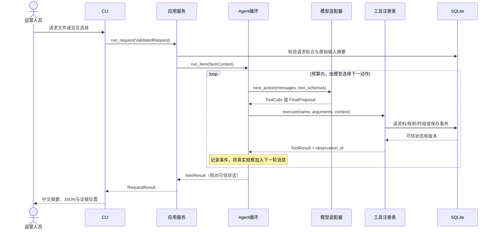

# 开发实现参考 v1

状态：设计完成，业务代码未实现。本文将已确认的 CLI、技术栈和业务要求落实为模块、接口、数据格式及验收规则。本文是后续开发的详细依据；与早期设计冲突时以本文为准，原始题目要求和用户后续明确指令优先。不得把本文的示例视为实际运行记录。

相关材料：[项目要求原文](08-project-requirements-original.md)、[需求与验收](01-requirements.md)、[总体架构](10-architecture-baseline.md)、[运行方式取舍](12-runtime-decision.md)。

## 1. 范围、技术与完成标准

实现 Python 3.13 CLI，原生单 Agent 工具循环，DeepSeek Tool Calls（默认模型沿用架构基线，非 thinking），HTTPX 异步调用，Pydantic 2 数据校验，SQLite 本地事务存储，pytest 和 Ruff。
模型选择已定，但 API 可用性、实际模型效果和依赖补丁版本待实现后验证；不虚构锁文件与通过率。

发布单元是某版本内容在单个平台、单个账号的一次拟发布对象。使用合成 JSON 和媒体引用；审核提供的元数据、文案和规则，不实现视频理解或真实发布。
一次请求 1–3 个发布单元，逐项处理。每项保存独立事务，部分成功不回滚其他项；没有全局最优排期承诺。

必须实现：

| 功能 | 具体完成条件 |
| --- | --- |
| 数据加载 | 素材、补充资料、规则、已有排期可显式导入，版本可识别 |
| 素材读取和补查 | basic/supplement 两类读取，返回来源与缺项，不补造未知 |
| 规则预检 | 输出 passed/needs_info/needs_review/blocked，规则 ID 与证据齐全 |
| 时段查询和建议 | 指定时间与候选查询，冲突后模型选择下一动作 |
| 草稿保存 | 保存前重新核查，返回真实保存结果和可查询 ID |
| 重复提交 | 同一逻辑请求的每素材仅一份草稿；重评估可以修订，不能重复新建 |
| 用户确认 | 接受/拒绝/暂不处理，绑定草稿修订，不能代替用户授权 |
| 失败与执行边界 | 预算、超时、工具错误、保存失败和结果未知清晰返回 |
| 使用入口 | seed/run/confirm/inspect-draft，以及 demo/review 交互包装 |
| 验证和交付 | 六个必验场景、两条真实模型路径、可执行测试与五份交付文档 |

不增加 Web、HTTP API、Notebook、企业账号权限、工时排程、多 Agent、视频生产或真实发布接口。

## 2. 模块如何通信

所有模块在同一 CLI 进程内调用 Python 函数，模块之间使用 Pydantic 对象或明确的结果类型。只有模型适配器对外发送 HTTP JSON。SQLite 是本地状态事实来源，JSONL 是事件记录；两者用途不同。



CLI 不直接访问模型、不执行 SQL、不决定审核通过；工具不调用模型；存储层不生成文案；模型适配器不理解草稿业务。
正常路径可能是读取→检查→查询→保存，但程序不按固定顺序替模型选择这些动作。违反前置条件的动作返回错误观察供模型调整。

## 3. 文件和函数职责

| 文件 | 接口（设计签名） | 职责 |
| --- | --- | --- |
| cli.py | main(argv) -> int | argparse、交互菜单、stdout/stderr、退出码 |
| service.py | async run_request(request, dependencies) -> RequestResult | 请求登记、逐项执行、部分成功、整体结果 |
| service.py | confirm_draft(decision, dependencies) -> ConfirmationResult | 与 review 共用确认服务，不经模型代签 |
| agent.py | async run_item(context, model, registry, trace) -> ItemResult | 消息、预算、动作、观察与退出 |
| models/base.py | async next_action(messages, schemas) -> ModelTurn | 统一 live/mock 接口 |
| models/deepseek.py | DeepSeekModel.next_action(...) | HTTP、工具调用 ID、响应解析与传输错误 |
| models/mock.py | MockModel.next_action(...) | 消费观察的确定性替身，显式标记为 Mock |
| tools/registry.py | execute(name, raw_arguments, context) -> ToolResult | 白名单、Schema、作用域、前置条件、计数 |
| tools/materials.py | read_material(args, context) -> ToolResult | basic 和 supplement |
| tools/rules.py | check_rules(args, context) -> ToolResult | 执行白名单规则，返回证据 |
| tools/slots.py | query_slots(args, context) -> ToolResult | 容量、候选和冲突来源 |
| tools/drafts.py | save_draft(args, context) -> ToolResult | 事务保存、复用、修订、保存后核对 |
| policy.py | validate_action / validate_finish | 检查前置条件与结束条件，不替模型选择下一工具 |
| storage.py | Repository + transaction context | 参数化 SQL、版本、唯一约束、查询和持久化 |
| result.py | assemble_result / render_summary | 根据可信状态输出固定格式；不直接采用模型的成功声明 |
| trace.py | emit(event) / write_run_metadata | 脱敏事件、观测引用、运行元数据 |
| contracts.py | 请求、观察、结果和枚举 | 一处定义模型和工具契约 |

dependencies 显式注入配置、Repository、Model、Clock、TraceSink；不以全局变量保存业务状态。先实现具体需求，不创建通用插件或工作流框架。

## 4. 请求与资料格式

所有 JSON UTF-8；请求、确认和运行结果带 schema_version="1.0"，fixture 数组和目录对象按下文格式导入，Trace 事件也带版本。ID 非空，时间必须带 UTC 偏移，未知业务事实用 null；未知字段报错。格式错误与业务信息不足分开：非法 JSON/时间格式拒绝执行；合法但缺必要业务事实的输入返回 needs_input。
记录中文文本，代码字段与枚举用英文。实际类型定义在 contracts.py，工具 Schema 从同一模型导出，避免重复维护。

### 4.1 用户请求 Request

```json
{
  "schema_version": "1.0",
  "request_id": "REQ-20261103-001",
  "items": [
    {
      "material_id": "M01",
      "publish_requirement": {
        "requested_at": "2026-11-03T18:00:00+08:00",
        "timezone": "Asia/Shanghai",
        "constraint": "hard",
        "candidate_times": [
          "2026-11-03T18:00:00+08:00",
          "2026-11-03T19:00:00+08:00"
        ]
      }
    }
  ]
}
```

platform/account_id/version 从可信素材读取，不让用户请求和模型各填一套相互矛盾的值。requested_at、timezone、constraint 允许 null 以覆盖信息不足，影响执行时必须澄清；非空值必须合法并一致。首版要求偏移与 IANA 时区匹配，环境缺时区数据时安装 tzdata 并锁定版本。
candidate_times 是用户允许查询建议的范围，不是已经授权改变时间。未提供候选列表时，候选取数据中对应账号的同日 allowed_slots，不自动跨日扩展；候选仍没有则询问用户。
mode、db、output、模型配置属于 CLI/运行配置，不参与原始业务请求摘要。items 不得重复 material_id。

### 4.2 素材 materials.json（数组）

```json
[
  {
    "material_id": "M01",
    "material_version": 2,
    "source_asset_id": "VIDEO-001",
    "title": "新品功能介绍",
    "type": "video",
    "platform": "douyin",
    "account_id": "brand_main",
    "media_ref": "synthetic://video/M01-v2.mp4",
    "caption": "支持字幕功能",
    "cover_ref": "synthetic://cover/M01-v2.jpg",
    "copyright_status": null,
    "license_ref": null
  }
]
```

synthetic:// 仅用于表示虚构资产，不自动下载或宣称真实文件存在。项目验证的是该元数据的业务流程。

supplements.json 存可补查字段和来源：

```json
[
  {
    "material_id": "M01",
    "supplement_version": 1,
    "fields": {"copyright_status": "authorized", "license_ref": "LIC-001"},
    "source_id": "SYNTHETIC-LICENSE-REGISTER"
  }
]
```

Agent 先 read_material basic，仅获得基本资料；选择 supplement 后才能把补充事实纳入本次有效素材快照。补充只允许填补白名单字段的未知值；与已知值冲突返回 DATA_CONFLICT，不静默覆盖。模型不能通过工具参数提交自己编造的元数据。

### 4.3 规则 rules.json（数组）

```json
[
  {
    "rule_id": "R-COPYRIGHT-MISSING",
    "version": 1,
    "field": "copyright_status",
    "operator": "missing",
    "value": null,
    "severity": "needs_info",
    "message": "缺少版权状态，请补查授权资料"
  },
  {
    "rule_id": "R-COPYRIGHT-DENIED",
    "version": 1,
    "field": "copyright_status",
    "operator": "equals",
    "value": "unauthorized",
    "severity": "blocked",
    "message": "未授权素材不得进入排期"
  },
  {
    "rule_id": "R-CAPTION-REVIEW",
    "version": 1,
    "field": "caption",
    "operator": "contains",
    "value": "最强",
    "severity": "needs_review",
    "message": "示例品牌规则要求人工核实该表述依据"
  }
]
```

首版只实现 missing/equals/contains；字段和运算符白名单，不执行 eval。missing 包括 null、空白文本；未知状态字符串视为字段校验错误，不能视为已授权。匹配规则合并：blocked > needs_info > needs_review > passed。未知规则、错误字段和非法配置在 seed 时拒绝，不降级为通过。示例不是法律或平台政策结论。

### 4.4 排期 schedule.json

```json
{
  "schedule_version": 1,
  "allowed_slots": [
    {"platform": "douyin", "account_id": "brand_main", "at": "2026-11-03T18:00:00+08:00"},
    {"platform": "douyin", "account_id": "brand_main", "at": "2026-11-03T19:00:00+08:00"}
  ],
  "entries": [
    {"entry_id": "S01", "platform": "douyin", "account_id": "brand_main", "at": "2026-11-03T18:00:00+08:00", "material_id": "M00"}
  ]
}
```

只检查同平台、同账号、同一个精确离散时刻；不把视频播放时长当成发布时间区间。不同时区的同一时刻按 UTC 判等；查询结果列明冲突来自 schedule 还是 draft。

## 5. 运行上下文和事实传递

ItemContext 由程序持有，至少包含 run_id、request_id、当前 material_id、不可变原要求、预算/截止时间、observations 映射、已读取有效素材、最新规则检查、候选查询、保存尝试和已有草稿修订。
模型只在当前素材范围内调用工具；请求范围外的素材 ID、伪造观察引用或其他用户确认被拒绝。全部模型文字与素材文本视为不可信数据，不能直接更新 context 的事实字段。

采用一个保守的 catalog_revision：资料、规则或已有排期实际变化时递增；同内容重新 seed 不递增。观察与草稿记录该版本和有效素材摘要。任何资料版本变化都要求刷新相关检查，可能造成额外复查，但能减少首版版本判断复杂度。
其他草稿变化不必让所有审核失效；时段在保存事务内重新检查。SQLite 存业务资料，只有本轮真实工具返回才能成为模型的已观察事实。

## 6. 工具参数和返回格式

所有工具参数可有 reason_summary 字段，存放简短动作依据，不包含内部思维过程。核心业务参数如下：

| 工具 | 参数 | 前置条件 |
| --- | --- | --- |
| read_material | material_id, detail: basic/supplement | 当前请求作用域内 |
| check_rules | material_id | 至少读取 basic；检查本轮有效快照 |
| query_slots | material_id, query: requested/alternatives | 已取得平台账号；原时间等必要信息明确 |
| save_draft | material_id, suggested_at, expected_revision, review_observation_id, slot_observation_id | 最新检查非 blocked/needs_info，候选曾被观察且可用 |

查候选只在合法候选集合内，模型不能通过参数扩展到任意账号和日期。save_draft 不接受 review_status、confirmation_status、request_id、draft_id 这些由程序决定的字段。

统一 ToolResult 示例：

```json
{
  "observation_id": "OBS-004",
  "tool": "query_slots",
  "ok": true,
  "code": "SLOT_CONFLICT",
  "retryable": false,
  "catalog_revision": 7,
  "data": {
    "requested_at": "2026-11-03T18:00:00+08:00",
    "available": false,
    "conflicts": [{"source": "schedule", "id": "S01"}],
    "candidates": []
  }
}
```

时段占用是成功查询到的业务事实，故 ok=true；未知工具、错误参数、保存冲突等动作未完成为 ok=false。工具实际异常也转换成错误观察并记录。不能把失败返回包装为空成功结果。
requested 查询只返回原时段；alternatives 查询才返回候选与各自占用，便于观察冲突后模型是否主动补查。
规则命中包含 rule_id、severity、field、observed_value、source_id、message；工具返回不把媒体文件、密钥或无限长文本送进模型。

## 7. 模型循环和结束协议

模型适配器输出 ModelTurn，其一为工具调用列表（保留提供方 call_id），其二为经过校验的 FinalProposal。
工具调用的 assistant 消息与每个 role=tool、tool_call_id 对应结果必须正确加入历史。多个调用串行执行；每个均校验当前状态，预算不足的未执行项也获得明确拒绝观察，不伪造执行。
Schema 以 Pydantic 定义为准，非法参数与无效结束可在预算内纠正。无效调用和纠正请求照常计数。

FinalProposal 只请求 finish/needs_input/block，并提交简短说明和观察引用；模型不直接决定保存结果或用户确认事实：

```json
{
  "action": "needs_input",
  "reason_summary": "原时段已占用，已找到替代时段，需要用户确认",
  "evidence_ids": ["OBS-003", "OBS-004", "OBS-005"]
}
```

程序从可信状态派生最终待确认项和结果。若模型试图在未核查规则/未保存时声称 completed，拒绝该结束并返回缺少哪些步骤；不得直接替模型偷偷完成业务链路。
资料不足、明确阻断或预算耗尽时可结束且保存未尝试。预算耗尽由程序强制停止，不再调用模型请求最后总结。
正常已保存后仍至少给模型一次消费保存结果并结束的机会；最后一轮没有预算则如实 incomplete，保留真实保存结果。
失败保存后模型可以在 retryable 且有预算时重试，否则结束。确定性的业务阻断不自动重试。

## 8. 输出格式与状态

结果示例（设计数据）：

```json
{
  "schema_version": "1.0",
  "run_id": "RUN-DEMO-001",
  "request_id": "REQ-20261103-001",
  "mode": "mock",
  "task_status": "needs_input",
  "items": [
    {
      "material_id": "M01",
      "material_version": 2,
      "review_status": "passed",
      "risk_reasons": [],
      "original_requested_at": "2026-11-03T18:00:00+08:00",
      "constraint": "hard",
      "suggested_at": "2026-11-03T19:00:00+08:00",
      "confirmation_status": "pending",
      "pending_items": [
        {"id": "change_time", "kind": "confirm", "message": "是否接受 19:00 替代原要求 18:00？"}
      ],
      "draft": {"id": "D001", "revision": 1, "validity": "active", "save_status": "saved", "error": null},
      "task_status": "needs_input",
      "evidence_ids": ["OBS-003", "OBS-004", "OBS-005", "OBS-006"]
    }
  ]
}
```

字段必须保留，未知值用 null；没有审核成功时 review_status=null，并附未完成原因，不能伪造 passed。
save_status 是本次操作结果，draft.validity 是持久化对象状态，两者分开。例如更新失败可能仍有历史 draft_id，但旧方案已 stale，不能展示为本次保存成功。

| 维度 | 枚举与派生规则 |
| --- | --- |
| review_status | null / passed / needs_info / needs_review / blocked；由规则工具派生 |
| confirmation_status | not_required / pending / confirmed / rejected；由明确待办和当前有效用户决策派生 |
| draft.validity | null / active / stale / rejected；active 只表示当前本地方案有效，不代表已经批准或发布 |
| save_status | not_attempted / saved / reused / updated / failed / unknown；由存储动作核实 |
| task_status | completed / needs_input / blocked / incomplete / failed |

pending_items 从缺项、可裁量风险和时间变化产生，稳定 ID 如 missing:license_ref、risk:R-CAPTION-REVIEW、change_time。补资料不是接受风险，不能用一次“同意”补造版权事实。
单项终态优先级：不可继续的技术错误 failed；预算或协议未完成 incomplete；明确规则阻断 blocked；缺项或待确认 needs_input；有效草稿已保存/复用且无未决事项才 completed。
批任务的 task_status 按 failed > incomplete > blocked > needs_input > completed 聚合，必须保留所有 items 独立结果。确认过的有效软风险可保持 review_status=needs_review，同时 pending 已解决、任务 completed；不把人工接受风险改写成原规则 passed。
summary.md 使用固定中文模板按这些字段渲染，避免模型自由文案虚报“已发布”。stdout 返回结果 JSON，交互摘要与进度走 stderr；review 是专用交互入口。

## 9. SQLite 结构和事务

| 表 | 关键字段及约束 |
| --- | --- |
| catalog_meta | 单行 revision、合成源数据摘要 |
| materials | material_id 主键、material_version、data_json |
| supplements | material_id 主键、supplement_version、data_json |
| rules | rule_id 主键、version、data_json |
| schedule | entry_id 主键、platform、account_id、at_utc；三者唯一 |
| allowed_slots | platform、account_id、at_utc 联合主键 |
| requests | request_id 主键、canonical_input_json、input_sha256 |
| drafts | draft_id 主键、request_id、material_id、revision、validity、platform、account_id、at_utc、catalog_revision、semantic_sha256、payload_json、updated_at |
| draft_history | draft_id + revision 联合主键，保存每一版 payload 与失效原因 |
| confirmations | operation_id 主键、draft_id、revision、decisions_json、decided_at |

drafts 上 UNIQUE(request_id, material_id)。有效时段用部分唯一索引 UNIQUE(platform, account_id, at_utc) WHERE validity='active' AND at_utc IS NOT NULL。此索引只约束草稿；与 schedule 的交叉冲突必须在事务中检查。
所有 SQL 使用参数绑定，所有业务写入通过同一 Repository。事务显式 BEGIN IMMEDIATE / COMMIT / ROLLBACK，busy 等待不超过 2 秒；不在数据库事务中等待模型或网络。
seed 默认仅初始化空库；更新资料需要显式 --update，以一个事务变更目录并递增 catalog_revision，保留草稿历史、标记受旧版本影响的有效草稿为 stale、释放本地规划容量。不得静默清库；demo 使用隔离路径。

## 10. 幂等、旧方案与保存步骤

### 请求登记

canonical 输入排除 run_id、mode、路径等运行字段，items 按 material_id 排序、候选时间按 UTC 去重排序、JSON 排序键序列化，再计算 SHA-256。
同 request_id 且摘要不同返回 INPUT_CONFLICT；相同摘要每次都重评估当前资料。幂等是同请求一份草稿，不是跳过观察。

### 保存事务

1. 核对请求身份、当前草稿 revision（新建为 0）、观察归属和引用真实性。
2. 核对 catalog_revision 和有效素材/规则快照，不一致返回 STALE_EVIDENCE，模型需重新读取和检查。
3. 核查最新规则状态、必需字段、候选范围、账号和时间。阻断或关键缺项返回 PRECONDITION_FAILED。
4. 在同一写事务内检查 schedule 和其他 active drafts，排除当前 draft_id；发现冲突返回 SLOT_CONFLICT，不落库新方案。
5. 比较语义摘要：material_version、有效资料摘要、规则命中及版本、原要求、建议时段和待确认项。排除措辞、观察 ID、时间戳和模型说明，避免随机文案导致假修订。
6. 已有 active 草稿与版本/证据都相同则 reused，不增修订、不清除有效确认；否则更新同一 draft_id、revision+1，记录历史并失效旧确认；新建从 revision=1 开始。
7. COMMIT 后返回 saved/updated/reused 及 ID；事务异常回滚并返回 failed。提交结果不明时用独立连接按逻辑键和预期语义摘要核对；仍无法确定则 unknown。

已有草稿重新评估时，应用服务先验证旧快照和占用：旧方案不再成立则用短事务标 stale 并记录原因；这是事实维护，不为模型选择替代方案。如果资料未变且旧方案有效，保持有效，不因启动 run 而释放其槽位。
旧方案有效、新建议保存失败时保留旧方案但报告本次失败；旧方案已经 stale 时不得把旧 ID 当成当前有效保存成功。新方案与失效方案语义相同时仍需重新校验并以新修订激活，不能直接 reused。
expected_revision 不匹配返回 REVISION_CONFLICT，避免并发覆盖。首版 CLI 执行状态正常时足够用；不承诺取消任意系统级阻塞或跨多个数据库的原子性。

## 11. 用户确认与 review

```json
{
  "schema_version": "1.0",
  "operation_id": "CONFIRM-001",
  "draft_id": "D001",
  "expected_revision": 1,
  "decisions": [{"item_id": "change_time", "decision": "accept"}]
}
```

confirm 服务在事务内检查当前修订、有效性、资料版本、规则和时段，再接受明确的待确认项。operation_id 重放同样内容复用结果，不同内容拒绝。
accept 只解决当前列出的可确认项；blocked 和 missing 项不允许接受为通过。所有项接受后 confirmation_status=confirmed，未解决项仍为 pending。reject 使方案 rejected、释放本地规划槽位；skip 不写入。
确认不修改方案内容 revision，而写独立审批记录；方案后来变化时这些记录保留历史，但不再作为当前确认依据。
review 展示精确标题、平台账号、日期时区、风险、原要求和建议，提供数字菜单；默认 skip，不从自然语言猜测用户同意。用户确认服务不调用模型。

## 12. 限制、故障和 CLI 契约

沿用架构基线：每项 16 次模型尝试、16 次工具尝试、180 秒；最多 3 项、总共 540 秒。连接 5 秒、读写 30 秒、整次模型调用 deadline 为 min(剩余预算, 30 秒)。临时错误最多额外重试 1 次，重试计数。
模型请求重试只重发未执行工具的模型请求，不重放上一轮保存；工具保存失败后的再次尝试用相同逻辑键。预算在任何副作用之前检查。
故障注入只在测试或显式 demo 场景中启用，不能让模型触发任意故障。支持素材读取错误、查询错误、保存前失败、提交后回执丢失、仅首次失败等明确类型。

| CLI | 行为 |
| --- | --- |
| seed --data data --db PATH [--update] | 校验全部 fixture 后事务导入，失败不部分更新 |
| run --input FILE --mode mock/live --db PATH --output DIR | 执行，生成真实结果和证据，输出目录不得覆盖已有运行 |
| confirm --input FILE --db PATH | 结构化确认，返回真实决策结果 |
| inspect-draft --id ID --db PATH | 当前草稿、修订和历史状态，不以旧报告代替当前状态 |
| demo [--mode mock/live] | 默认 Mock，使用独立数据目录和稳定请求，重复运行可观察幂等 |
| review --db PATH | 数字菜单，调用同一 confirm 服务 |

所有命令尚未实现。退出码：0=completed 或成功查询，2=输入/配置错误，3=needs_input，4=blocked，5=incomplete，1=failed。演示说明包含非零业务状态的含义，不能把待确认误当崩溃。参数显式给 mode；demo 默认 mock；Mock 不需要密钥。
进度和说明走 stderr，机器结果走 stdout。输出目录生成 input.json、output.json、summary.md、trace.jsonl、run.json；没有伪造运行日志的静态填充步骤。

## 13. Trace 和证据契约

JSONL 一事件一行，共同字段：schema_version、run_id、event_id、material_id、step、timestamp（UTC ISO）、mode、event_type、elapsed_ms、budget_remaining。
事件类型：model_action、tool_result、final、error、state_change。模型动作保留 tool_call_id、工具和脱敏参数、简短依据；tool_result 保留 observation_id、返回摘要和资料版本。观察与下一动作可通过调用历史和步骤关联。
不保存 reasoning_content 或要求内部思维过程；原始响应仅保留必要工具动作和可公开解释字段。生成摘要不替代工具实际返回的可信状态。
run.json 记录开始结束、命令的非敏感参数、源码 commit 或内容摘要、模型请求及返回标识、配置预算、退出码和输出文件清单。无密钥或私密真实资料。
资料、模型或工具不可用时如实产生错误证据；Mock 与 live 文件明确区分。

## 14. 验收、实现顺序与设计理由

| 用例 | 必须验证的行为 | 主要层 |
| --- | --- | --- |
| B01 正常 | 原时间可用，规则 passed，数据库真实保存，completed | 工具/集成/live |
| B02 缺资料 | 模型补查；补齐后继续，补不到则 needs_input，不伪造事实 | 循环/规则/live |
| B03 风险 | needs_review 与 blocked 不混淆；阻断无法被普通确认绕过 | 规则/策略/确认 |
| B04 冲突 | requested 返回冲突后模型查询 alternatives；建议待确认，原 hard 要求不变 | 循环/live |
| B05 重复 | 跨两个 CLI 进程运行，草稿行数为 1，ID 相同，语义未变不加修订 | CLI/数据库 |
| B06 保存失败 | 明确注入回滚，保存 failed，成功审核保留，无新成功行 | 工具/输出 |
| B07 改占用再提交 | 同请求重观察，旧方案失效，新建议修订同一 ID，旧确认不复用 | 数据库/循环/live |
| B08 确认 | 修订不匹配拒绝，正确确认接受，阻断不可接受，skip 不写入 | 服务/CLI |
| B09 标识冲突 | 同请求不同输入拒绝，不覆盖或多建草稿 | 服务/数据库 |
| 边界 | 非法参数、未知工具、伪造观察、过期资料、同时抢槽、预算耗尽、回执丢失后核对 | 单元/集成 |

按以下顺序实现，每步可独立验证：

1. contracts、fixtures、Repository：格式校验、规则运算、时间比较、唯一约束和事务。
2. 四类工具及确认服务：先验证确定性副作用，模型尚未接入时不声称有 Agent 决策。
3. 原生循环与 DeepSeek 最小真实调用：保留 tool_call_id，观察回传，至少正常和冲突两条路径。
4. 请求服务、中文结果、demo/review：复用工具和确认服务，完成六类场景。
5. 同请求重评估、故障注入、真实证据、干净安装、文档和实际用时记录。

设计理由：结构化契约减少模型输出歧义；单进程函数通信减少接口成本；事实与模型建议分开保证保存和确认可信；SQLite 事务和稳定逻辑键解决去重与冲突；修订保证修改后不能沿用旧确认；独立状态避免把通过预检误当发布成功；双入口兼顾评审复现与操作体验。
保守目录版本可能使无关变化也触发复查，逐项处理不能保证批次最优，元数据审核不能代表真实视频审核，本地确认不代表企业身份鉴权。以上边界必须在 README 和评估中保留。

开发中若要改变本契约，先写明具体原因及受影响测试并同步更新关联文档。实际代码与测试发现的问题优先据实修订，不为了维持设计文本掩盖失败。
