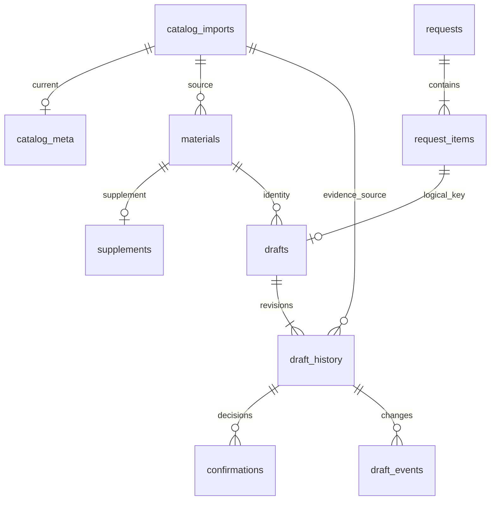

# 数据库设计与调用规范 v1.0

2026-11-01当前审核修复与实际状态以 [第26号契约](26-review-remediation.md) 和 [v5证据](../examples/review_remediation_v5/README.md) 为准；下方阶段描述保留历史语境。数据库列未迁移，新字段在请求JSON/历史payload中保存。
2026-10-31 调用语义增补见 [第 19 号规范](19-local-model-boundary.md)：内部 ID 和证据继续完整存本地，模型只接收业务投影；allowed_slots 作为全部已配置节点，不按同日截断；查询返回两侧各一最近空闲建议并保存实际核查证据。13 表结构及确认、唯一键不变，无需为本次工具投影修改 DDL。

状态：2026-10-30 数据库设计基线。用户选择完整快照导入、草稿证据快照，并补充导入记录、版本复核和状态事件。本文件细化 [开发实现参考](13-implementation-reference.md) 第 9–11 章；不改变原要求、确认、幂等和模型动作边界。后续契约、迁移与 Repository 已有阶段一记录，实际验证范围见 [阶段记录](16-implementation-progress.md)，不等同完整 Agent 业务验收。

完整字段、SQL 类型、数据库约束和索引见 [DDL 设计附件](15-database-schema.sql)。该附件用于检查设计可执行性，不代表应用已经建库。本文的流程和示例是设计，实际检查结果另见 [评估记录](03-evaluation.md)。

## 1. 选择与范围

使用 Python 3.13 标准库 sqlite3，一个本地 SQLite 文件，不引入 ORM。首版共 13 张表：6 张当前资料表、1 张导入记录表、2 张请求表、4 张草稿与审计表。

| 领域 | 表 | 用途 |
| --- | --- | --- |
| 当前资料 | catalog_meta、materials、supplements、rules、schedule、allowed_slots | 当前目录版本、素材、补查、审核规则、已有占用和默认候选 |
| 导入 | catalog_imports | 完整快照导入的版本、摘要、数量与变更记录 |
| 原始请求 | requests、request_items | 不可变的原要求及其规范摘要；建立草稿的合法请求作用域 |
| 草稿与审计 | drafts、draft_history、confirmations、draft_events | 当前方案、各版证据、明确用户决定、状态变化 |

不增加用户权限、真实发布、全库历史、通用事件溯源或任务调度表。run_id 标识实际运行，request_id 标识不可变业务请求，两者不能混用。Trace 继续按运行写入 JSONL，数据库不存模型完整对话或内部思维过程。

SQLite 的部分唯一索引可以约束满足条件的行；外键需在每个连接上明确启用。选择这些机制的技术依据见 [部分索引](https://www.sqlite.org/partialindex.html)、[外键](https://www.sqlite.org/foreignkeys.html)。

## 2. 类型、时间与 JSON 的统一约定

- 标识符为非空 TEXT，应用去除首尾空白后校验；draft_id、import_id、storage_write_id、event_id 由程序生成 UUID，不由模型分配。不使用含业务秘密的 ID。
- 版本为正整数；is_current 为 INTEGER 0/1；枚举由 CHECK 限制。DDL 使用 STRICT 表，启动时检测运行库和 JSON 函数能力，不假定 Python 版本等于 SQLite 版本。
- at_utc、requested_at_utc 和审计时间均存固定格式 UTC TEXT，例如 `2026-11-03T10:00:00.000000Z`。通过 Python aware datetime 转换，统一到其微秒精度；超出可无损表达精度的输入拒绝而不静默截断。禁止混存本地时间、不同精度字符串或无偏移时间。时区合法性、偏移一致性由契约层校验，SQL TEXT 不能承担该校验。
- 请求保留 IANA timezone；requests.submitted_input_json 保留首次登记的合法原始表达，规范字段用于比较，输出按原时区呈现。后续同语义重放不覆盖首次原要求。
- JSON 存 TEXT，数据库校验 json_valid；对象结构、字段白名单、类型和跨字段约束由统一的 Pydantic 契约校验。严禁把“JSON 语法正确”视为业务合法。
- 查询、唯一键和关联使用普通列；少量候选、字段来源、规则证据和确认列表使用 JSON，避免为最多 3 项的 CLI 创建无必要的通用框架。
- SHA-256 为 64 位小写十六进制；数据库检查长度，契约校验字符集，应用从可信数据计算，模型传来的 hash 不可信。

STRICT 的支持要求参考 [SQLite STRICT](https://www.sqlite.org/stricttables.html)。本项目使用能力检测，不以文档示例伪造依赖兼容性验证。

## 3. 当前资料与导入字段

### catalog_imports：导入记录

| 字段 | 类型、空值与约束 | 含义 |
| --- | --- | --- |
| import_id | TEXT，PK | 每次成功导入或无变化核对的标识 |
| previous_revision、catalog_revision | INTEGER，非空 | 导入前后目录版本；首次 0→1；实际变化 +1，noop 不变 |
| outcome | TEXT，applied/noop | 数据变更或内容完全相同 |
| source_label | TEXT，非空 | 非敏感来源名，例如 synthetic-fixtures；不写凭据与无必要绝对路径 |
| source_sha256 | TEXT，非空 | 全部规范化资料的内容摘要，不是原始文件字节摘要 |
| schedule_version | INTEGER，正数 | 输入排期文件提供的业务版本 |
| manifest_json | TEXT，非空对象 | 四个文件的规范摘要和记录数、导入契约版本；不保存完整目录 |
| changes_json | TEXT，非空对象 | 新增、修改、退出当前目录的 ID 和数量、失效草稿 ID/原因；不塞入完整文案 |
| imported_at | TEXT，非空 | 事务内使用同一可信时钟产生的 UTC 时间 |

相同内容重复导入可增加一条 noop 导入记录，但不更新当前资料、不递增目录版本、不失效草稿。失败导入整体回滚，不留貌似成功的 applied 行；失败原因由 CLI 错误和运行事件记录。source_sha256 不唯一，允许未来重新导入以前用过的内容。

### catalog_meta：当前目录单行

singleton_id 固定为 1（PK）；revision、current_import_id、source_sha256、schedule_version、updated_at 均非空。复合外键 `(current_import_id, revision)` 指向 catalog_imports，避免把当前版本和错误导入批次拼在一起。

首次导入成功前无该行，业务读取返回“资料尚未初始化”；不能以 revision=0 的半成品目录运行。current_import_id 指向最近一次 applied 导入，noop 不改变它。数据库结构版本另外使用 PRAGMA user_version，不与业务目录版本混用。

### materials：每个发布单元的最新基本资料

| 字段 | 类型、空值与约束 | 含义 |
| --- | --- | --- |
| material_id | TEXT，PK | 发布单元身份 |
| material_version | INTEGER，正数 | 输入素材版本 |
| platform、account_id | TEXT，非空 | 可信的平台和账号 |
| source_asset_id、title、media_ref、caption、cover_ref、license_ref | TEXT，可空 | 六个可缺失业务事实；空白规范为 null |
| type | TEXT，可空，video/image/text | 素材类型 |
| copyright_status | TEXT，可空，authorized/unauthorized | 已提供的版权状态，未知为 null |
| content_sha256 | TEXT，非空 | 身份、版本与全部基本事实的规范摘要 |
| is_current | INTEGER，0/1 | 是否仍在当前导入目录中 |
| last_import_id | TEXT，FK，非空 | 最近一次出现或退出当前目录的 applied 导入 |

八个业务字段可空，必填性由导入规则决定。文件中缺席的素材设 is_current=0，不删除它及其历史关联；正常读取必须过滤 is_current=1。旧行只保留最后状态，不能冒充完整素材版本历史。跨平台、跨账号发布单元仍按既有粒度使用不同 material_id。

### supplements：补充资料

material_id 为 PK 和到 materials 的 FK；supplement_version（正整数）、source_id（非空 TEXT）、fields_json（字段对象）、content_sha256、is_current、last_import_id 均非空。每素材首版最多一条当前补充资料。

导入时要求其素材出现在同一完整快照中；FK 仅检查身份存在，当前有效性由导入服务检查。fields_json 仅允许八个业务字段，不得修改身份。读取补充资料不会写回 materials，只合入本轮有效快照；冲突整次不合并，保持原来源。补充侧缺省/null/空白均为未知，不覆盖或冲突；两侧已知且不同才判冲突，已知相同保留原来源，基本未知且补充已知才填入并标注补充来源。null 不表示删除，规范化后的 null 仍保留在导入字段快照中。补充资料缺席时停用旧记录，不从旧导入捞回补查结果。

### rules：当前规则

rule_id 为 TEXT PK；version 为正整数；field、operator、value_json、severity、message、content_sha256、is_current、last_import_id 均非空。字段、运算符、severity 的数据库枚举见 DDL。

value_json 存 JSON 标量，missing 对应文本 `null`，不是 SQL NULL。equals/contains 的合法值及字段适配按实现参考校验。当前规则必须是有效非空集合；退出目录的规则停用。规则条件不执行 eval。历史草稿保存实际用过的完整规则定义，不依赖 rules 当前行还保留旧内容。

### schedule：已有外部占用

entry_id 为 TEXT PK；platform、account_id、at_utc、material_id、import_id 均非空；`UNIQUE(platform, account_id, at_utc)` 限制同账号同精确时刻只有一条已有占用。每行通过 import_id 引用当前 applied 导入。

material_id 是来源系统提供的引用，**不强制外键到 materials**：例子中的占用 M00 可以不在本次待审核素材目录中。schedule 不能因本地没导入 M00 就忽略冲突。该表表示接入的已有安排，不声明已经发布。

### allowed_slots：默认候选

platform、account_id、at_utc 为非空联合 PK，import_id 为非空 FK。仅保存当前默认候选；原要求和显式候选不需引用本表，也不受本表外键限制。

schedule、allowed_slots 在一次完整快照更新中替换为新集合；它们没有被历史表作为行级外键引用，旧证据已经复制进草稿快照。允许明确的空集合，缺文件则是错误。

## 4. 原始请求字段

### requests：不可变请求头

request_id 为 TEXT PK；schema_version 固定 1.0；submitted_input_json、canonical_input_json、input_sha256、created_at 均非空。首次登记后不 UPDATE 或 DELETE。

规范摘要与执行都按 material_id 排序；候选按 UTC 去重排序；省略/null 统一为默认候选，[] 保持独立；排除 mode、输出路径和 run_id。相同 request_id 需同时核对规范内容和摘要：相同则复用登记，内容不同为 INPUT_CONFLICT。input_sha256 不加 UNIQUE：不同 request_id 即使内容相同也是独立请求。

### request_items：不可变原要求及草稿作用域

| 字段 | 类型、约束 | 含义 |
| --- | --- | --- |
| request_id、material_id | TEXT，联合 PK | 同请求不重复素材；request_id 外键到 requests |
| requested_at_utc | TEXT，可空 | 原始要求的绝对时刻，永不改写成建议 |
| timezone | TEXT，可空 | 原始 IANA 时区 |
| constraint_kind | TEXT，可空，hard/soft | 是否硬性；两者都不批准改期 |
| candidate_times_json | TEXT，可空 JSON 数组 | SQL NULL=默认范围；[] = 无替代范围；非空数组=用户显式 UTC 候选 |

头和 1–3 个明细同事务登记。这里 material_id **不加到 materials 的 FK**：用户可能请求未知素材，仍应保留原始请求并由读取工具如实返回未找到，不能制造虚假素材行。真正保存草稿时另有素材 FK 和当前资料校验。请求中的空时间字段允许登记，但不允许查询时段或保存方案。

不单独拆 candidate_times 子表，规模很小且没有独立更新需求；数组内容、数量和时间合法性由统一契约验证。其规范表达必须与 canonical_input_json 一致，由登记服务一次生成。

## 5. 草稿、证据、确认与事件字段

### drafts：每个逻辑请求的当前草稿

| 字段 | 类型、约束 | 含义 |
| --- | --- | --- |
| draft_id | TEXT，PK | 跨修订稳定的草稿身份 |
| request_id、material_id | TEXT，非空，联合 UNIQUE/FK | 同请求同素材只有一份，且必须属于 request_items |
| material_id | 同时 FK 到 materials | 已知素材才有草稿；停用素材行保留，不破坏历史 |
| revision | INTEGER，正数 | 当前方案修订；新建为 1 |
| validity | TEXT，active/stale/rejected | 当前本地方案的有效性 |
| platform、account_id、at_utc | TEXT，非空 | 当前修订的平台、账号、建议绝对时刻 |
| catalog_revision | INTEGER，正数 | 当前方案使用的目录版本 |
| semantic_sha256 | TEXT，非空 | 方案语义摘要 |
| created_at、updated_at | TEXT，非空 | 创建与当前状态更新时间 |

`(draft_id, revision)` 延迟外键到 draft_history，保证提交时当前修订真的有证据快照。相反，history.draft_id 外键到 drafts；首次保存先 INSERT drafts，再 INSERT history，延迟约束在 COMMIT 时核对。两者不能拆成两个事务，不能用 INSERT OR REPLACE 绕过关联。

每一份已保存方案都有建议时刻，所以 at_utc 非空。stale/rejected 行保留旧时刻供审计，但结果组装只对 active 显示当前 suggested_at；它们不参与容量索引。信息不足、阻断、无可用时段的本次结果进入运行证据，不创建空草稿。

### draft_history：不可变的每版方案与证据

| 字段 | 类型、约束 | 含义 |
| --- | --- | --- |
| draft_id、revision | 联合 PK；draft_id 为 FK | 所有已成功保存的修订，包含当前版 |
| storage_write_id | TEXT，非空 UNIQUE | 程序生成的本次新建/修订写入凭据，用于提交回执丢失核对 |
| catalog_revision、import_id | 非空复合 FK 到 catalog_imports | 使用的资料版本及导入来源 |
| material_version | INTEGER，正数 | 当时的素材业务版本 |
| effective_material_sha256 | TEXT，非空 | 实际观察到的 basic 或 basic+supplement 有效事实摘要 |
| semantic_sha256 | TEXT，非空 | 当时方案摘要，与 drafts 当前投影一致 |
| review_status | TEXT，passed/needs_review | 仅允许可保存的规则结论 |
| payload_schema_version、payload_json | TEXT，非空 | 证据契约 1.0 及自包含快照 |
| created_at | TEXT，非空 | 成功保存这一修订的时间 |

payload_json 至少包含：原要求及其规范摘要、平台账号与素材版本、有效素材全部八个业务事实和逐字段来源、是否补查及实际使用的补充版本、完整适用规则集和版本/内容摘要、实际命中与审核结果、原时段/合法候选查询结果和冲突来源、保存时的占用复核摘要、建议时刻、决定前的完整 confirm 事项定义、run_id 和观察引用。没有命中的规则也要保留，才能解释 passed。

快照不复制完整媒体、全库、原始模型上下文；媒体引用不能证明真实文件存在。候选列表为空、部分占用或全部占用等实际观察仅按本轮发生的情况记录，不补造未调用工具的观察。

每版 payload 仅 INSERT，不 UPDATE/DELETE。确认、失效和被下一版替代都不修改旧快照。drafts 不再重复存一份 payload_json，inspect 用当前指针 JOIN history；避免两份 JSON 互相覆盖。

语义摘要覆盖素材版本、有效事实、规则定义/版本和命中、原要求、建议时刻、决定前的确认事项定义；排除模型措辞、观察 ID、时间戳和接受/拒绝状态。目录版本单独比较：即使业务语义相同，stale 激活也必须新修订，不能 reused。

### confirmations：明确用户决定与幂等回执

operation_id 为 TEXT PK；draft_id、revision 为到 history 的联合 FK；canonical_input_json、input_sha256、decisions_json、result_json、actor_source、decided_at 均非空。actor_source 为 cli/review，只描述入口，不冒充已鉴权用户。

canonical_input_json 保存完整规范输入，包括 skip；decisions_json **只存实际接受或拒绝项**。所有 skip 不写本表、事件或状态。部分 accept+skip 只记录 accept，但后续 operation_id 重放仍按包含 skip 的完整输入比对。accept/reject 混用、重复 item_id、input 项或未知项整体拒绝。

同 operation_id 同内容先返回原 result_json，再独立提供当前草稿状态；即使草稿后来 stale 或修订，也不能把原操作回执伪装成“当前仍有效”。同 ID 异内容拒绝。首次操作才校验当前 active 修订和未决事项；否则重复接受已经解决的事项会错误破坏幂等。

不设置 UNIQUE(draft_id, revision)，因为同一修订允许分次接受不同风险。事务内聚合该修订的决定，防止同一事项再次被其他 operation_id 决定；列表规模小，首版无需再拆确认明细表。

### draft_events：提交成功的状态变化

event_id 为 TEXT PK；draft_id、revision 为 history 联合 FK；event_type、to_validity、reason_code、details_json、occurred_at 非空；from_validity、operation_id、import_id、run_id 可空。

event_type 为 created/revised/staled/accepted/rejected；operation_id 若非空，与 draft_id/revision 一起外键到 confirmations，防止串用别的草稿决定；import_id 若非空引用导致失效的导入。run_id 关联运行目录，无运行表 FK。

created/revised 事件附着新修订，details 记录 previous_revision；staled 附着失效修订；accepted 不必改变 validity，但记录实际接受项；rejected 使 active→rejected。事件与对应状态、快照或决定同事务写入。事件只追加，reused/skip 不制造状态变化事件。

历史状态由这些事件说明，不在 history.payload 中回填“失效”，更不从旧确认记录推导当前一定 confirmed。失败写入已回滚则没有成功状态事件，错误仍进入运行 Trace。

## 6. 关系与删除规范



图省略规则、排期、补充资料及事件到导入记录的来源边，精确外键以 DDL 为准。current 草稿到历史的指针在上述一对多关系之外另有延迟 FK。

不级联删除 requests、drafts、history、confirmations、events 或 imports；首版没有删除这些审计对象的业务入口。materials/supplements/rules 缺席使用 is_current=0；重新出现时重新参与当前目录，不自动恢复旧草稿。schedule/allowed_slots 可事务替换。历史引用不对当前 rule_id、entry_id 建 FK，因为它们的旧版本已自包含在快照里。

## 7. 索引与约束职责

| 索引/键 | 已覆盖的查询或保护 | 不额外重复建索引的原因 |
| --- | --- | --- |
| UNIQUE drafts(request_id, material_id) | 幂等定位、按请求找草稿 | request_id 单列查询可以使用此前缀 |
| ux_drafts_active_slot(platform, account_id, at_utc) WHERE validity='active' | active 草稿之间容量为 1、冲突查询 | stale/rejected 自动退出索引；不是真实平台占位 |
| UNIQUE schedule(platform, account_id, at_utc) | 已有排期冲突、账号范围查询 | 同时提供查询索引 |
| PK allowed_slots(platform, account_id, at_utc) | 按账号查询同日默认候选 | 使用 UTC 起止范围；不对列套时区函数 |
| PK request_items(request_id, material_id) | 请求作用域、确定性逐项读取 | 无需冗余 request_id 索引 |
| PK draft_history(draft_id, revision) | 精确版本、按草稿读历史 | 无需冗余 draft_id 索引 |
| UNIQUE draft_history(storage_write_id) | 精确核对不明提交 | 与 request_id 不同，不改变业务幂等键 |
| ix_drafts_material(material_id) | 素材关联查找和 FK 子表查询 | 幂等索引非 material_id 前缀，无法替代 |
| ix_confirmations_draft_revision(draft_id, revision) | 当前版决定聚合、历史确认查询 | operation_id PK 无法覆盖 |
| ix_draft_events_revision(draft_id, revision, occurred_at, event_id) | 按修订查看事件 | event_id 只作同时间下稳定展示，不代表业务顺序 |
| ix_imports_revision(catalog_revision, imported_at) | 按目录版本核对导入/noop | import_id 随机，不适合版本检索 |

其他导入外键不为小数据批量读取另加索引；其父表无日常删除/改主键操作。当前规则和小型待办列表允许扫描，不提前为每个枚举和 JSON 字段建索引。实现时用 EXPLAIN QUERY PLAN 核查关键冲突查询，无实测不宣称性能收益。

active 时段索引只能约束 drafts 内部，不能约束它与 schedule 两张表的交叉冲突；后者必须在同一个写事务中检查。CHECK/FK 也不能证明用户已经同意、工具真的运行过或规则确实通过，这些由受限应用服务与可信观察共同保证，不复制成另一套 SQL 业务引擎。

## 8. 连接与 Repository 调用规范

调用链：CLI → service / agent → tools / confirmation service → Repository → SQLite。只有 storage 模块执行 SQL；CLI、模型、结果渲染均不接触 connection。模型不能传入 SQL、request_id、draft_id、账号或任意排除占用条件。

建议的内部接口是 register_request、read_material_basic、read_supplement、read_rule_snapshot、query_occupancy、apply_catalog_snapshot、revalidate_current_draft、save_draft、confirm_draft、inspect_draft、resolve_save_outcome。它们使用明确的 Pydantic/结果对象，连接与 cursor 不向外泄露；不是新增模型工具。

1. 连接用 `sqlite3.connect(path, timeout=2.0, autocommit=True)`；每连接执行 `PRAGMA foreign_keys=ON` 并读回验证，设置 `PRAGMA busy_timeout=2000`、`PRAGMA synchronous=FULL`。首版沿用本地回滚日志，不为小型 CLI 增加 WAL 运维要求。路径只来自可信配置。
2. 写事务明确执行 SQL `BEGIN IMMEDIATE` / `COMMIT` / `ROLLBACK`。在 autocommit=True 模式下，不依赖 connection.commit()/rollback() 或 with connection 自动完成这一事务。只由事务所有者结束事务，禁止嵌套 BEGIN，必要的内部函数接受同一事务上下文。
3. 全部值使用 `?` 或命名参数绑定；SQL 表名/排序只允许代码常量。禁止拼接工具文本、使用 INSERT OR REPLACE 删除重建有历史的对象，或把冲突异常当成成功。
4. 一个连接只属于创建它的线程/执行单元；不关闭线程检查来共享。Agent 同轮工具串行，小型同步数据库操作保持短小；未来如转工作线程，连接也在该线程创建和关闭，不跨 await 共享写事务。
5. 素材/规则/候选各次观察需要从同一短读事务读取资料及 catalog_revision，读取完即释放。不得在数据库事务中等模型、HTTP、用户输入或写 Trace 文件。
6. busy 等待取不超过 2 秒且不超过剩余预算；进入副作用前检查预算。技术重试遵循既有最多额外 1 次，不能让存储层另套无限重试。`SQLITE_BUSY` 与磁盘满、权限、约束冲突分别映射，不一律视为可重试。
7. 提交成功才返回可信 ID；Trace 写入失败不能倒推数据库回滚，也不能重新执行已经提交的保存。结果组装同时区分本次操作结果和当前持久化有效性。

Python 事务与参数绑定依据：[Python 3.13 sqlite3](https://docs.python.org/3.13/library/sqlite3.html)；BEGIN IMMEDIATE 的单写者语义依据：[SQLite 事务](https://www.sqlite.org/lang_transaction.html)。

## 9. 四条写入事务

### 9.1 完整快照导入

1. 在事务外读取四个文件到内存，统一契约校验全部数据、重复 ID、补查关联、非空有效规则集、时间和排期唯一性；缺任一文件失败，显式空排期/默认候选合法。对内存对象生成规范摘要和变更预览，不在提交时重新读取可能被改过的文件。
2. BEGIN IMMEDIATE 后重读当前目录版本和摘要，重新计算与数据库的差异。默认 seed 只允许尚未初始化的空库；已有目录必须显式 --update，不清库。
3. 完全相同时只写 noop 导入记录。实际不同则写 applied 导入，revision+1；停用缺席素材/补充/规则，写当前资料并替换 schedule/allowed_slots，最后更新 catalog_meta。
4. 首版遵循保守目录版本：所有基于旧目录的 active 草稿一起 stale，并逐条写事件、释放本地容量；stale 保持 stale，rejected 永远不能被更新转成 stale/active。明确显示这是目录变化要求复查，不能伪称逐条证实了冲突。
5. 上述变更和失效同事务 COMMIT；任一步失败全部回滚。新排期与旧草稿冲突时，导入反映外部事实并失效旧方案，不能为保住草稿而拒绝真实占用或偷偷改外部时段。

完整快照只作用于这一数据库中的单一合成目录，不把某平台筛选导出误当全库。文件数和 Schema 校验不能发现所有“合法但人为漏项”，变更预览用于暴露退出数量/ID；首版不自动猜测、自动补回或自动扩大导入范围。

业务版本与内容均参与目录摘要：不能因为 material_version、rule.version 或 schedule_version 没改就忽略真实内容变化。catalog_revision+内容快照是首版防止旧证据复用的依据，不新增未经说明的版本回退/单调递增业务限制。

### 9.2 请求登记

BEGIN IMMEDIATE；按 request_id 查询，不存在则 INSERT 请求头和全部明细；存在则核对规范内容/摘要。冲突整体拒绝，不改旧请求或草稿。同一请求接下来的各项保存分别提交，后项失败不回滚前项。

### 9.3 草稿保存与旧方案维护

应用服务启动本项时，以短写事务核查已有 active 草稿：版本/事实/占用不再成立就 stale+事件并提交；成立则保留。此步骤只维护事实，不替模型选择新方案。保存事务内仍要重做必要复核，不能只信启动时结果。

模型选择 save_draft 后，registry 先验证观察属于本轮当前素材，程序构建可信 SaveCommand，包含观察事实、原要求、预算和预期修订。SQL 事务内：

1. 读取请求、当前草稿，核对 expected_revision（无草稿为 0）；拒绝 rejected 和不符修订，不能猜新编号覆盖。
2. 核对当前目录版本、is_current、平台账号、有效资料、完整规则依据、规则结论、明确的原时间要求；规则不能 passed/needs_review 以外。补查合并必须来自本轮真实观察。
3. suggested_at 必须是本轮已观察可用的原时刻或合法候选。再查询 schedule 与其他 active 草稿；排除当前逻辑键对应 draft_id，不能排除同素材的其他请求。占用变化不等于目录版本变化，始终查询。
4. 旧方案成立且语义和资料版本一致：reused，不改修订、快照或确认。否则在相同 draft_id 上 CAS 更新到 revision+1；新建 revision=1，新增 history 和 created/revised 事件；所有当前投影与快照摘要必须一致。
5. 当前 validity 只在有效保存后为 active；新修订自然不聚合旧版确认。旧 active 方案有效但新建议保存失败时保留旧方案；旧方案已 stale 则不得假装仍有当前建议。事务失败回滚，报告本次 failed。

没有原要求就绪、真实规则和时段观察时，Repository 拒绝写入，不代替模型补做工具调用。

冲突查询的核心条件如下，参数由程序上下文生成：

```sql
SELECT 'schedule' AS source, entry_id AS id
FROM schedule
WHERE platform = :platform AND account_id = :account_id AND at_utc = :at_utc
UNION ALL
SELECT 'draft' AS source, draft_id AS id
FROM drafts
WHERE platform = :platform AND account_id = :account_id AND at_utc = :at_utc
  AND validity = 'active'
  AND (:self_draft_id IS NULL OR draft_id <> :self_draft_id);
```

### 9.4 用户确认

在事务外收集显式用户输入，随后 BEGIN IMMEDIATE：先按 operation_id 检查重放，再核对当前修订、active、目录版本、规则、占用和未决 confirm 事项。旧证据不允许批准；若发现当前方案失效，提交 stale+事件这一事实维护，再返回明确的确认拒绝，不写确认成功记录。

合法决定与 confirmations/事件一起提交；accept 不改 revision，只解决该版相应事项；reject 任一未决项使整份 active 草稿 rejected 并释放容量。部分接受仍 pending，全部接受为 confirmed，原本没有 confirm 事项为 not_required。相同请求重跑不能恢复 rejected。全 skip 作为无操作，不运行会修改状态的维护事务、不写任何表；无效项和混合 accept/reject 整体拒绝。

操作重放不重新执行批准或变更状态。结果须区分 stored_operation_result 与 current_draft 状态，避免一次旧成功回执掩盖后来目录变化。

## 10. 保存失败与提交不明

save_status 属于本次调用，不在 drafts 存一个会被后次运行覆盖的“保存成功”标记；运行结果和 Trace 记录每次尝试。draft.validity 属于持久化对象。

- 已知校验拒绝或回滚完成：failed；未调用保存为 not_attempted。先前有效草稿可以仍存在，不能凭“本次失败”声称库里没有草稿。
- 成功 COMMIT：saved/updated；合法复用为 reused。不增加 published 状态。
- 新建/修订提交回执丢失：先关闭或隔离原连接，使用独立连接以 storage_write_id 查 history，并核对逻辑键、预期修订及语义摘要。该写入凭据与新快照同事务落库，可在当前版已经被后续运行修改时仍证明原写入确实发生。
- 查到本次写入不代表方案当前仍 active；另读 current 指针和有效性，必要时输出 incomplete 或需重评估，不用旧成功覆盖当前事实。
- 仅发现同语义草稿但不同 storage_write_id，不能声称本次写入已提交。可在再次完整复核后按真实 reused 返回；无法核实仍 unknown/incomplete，禁止盲重试。
- 只有排除原事务仍可能提交且独立连接可用、确认无本次写入后，才认定没有提交并按预算有限重试。核对本身失败或资料库不可读时保持 unknown；复用分支没有新写入，回执丢失后也需重新核查当前草稿。

storage_write_id 是内部写入凭据，不进入模型参数，也不替代 `(request_id, material_id)` 业务唯一键。失败不会通过插入假的 history 或 success 事件来“补日志”。

## 11. 历史、迁移与恢复边界

首版保留全部请求、草稿修订、确认、导入摘要和状态事件，不提供定时清理。Repository 禁止更新历史快照/确认/事件；不以触发器重复实现整套业务策略。数据库约束保护引用和唯一性，不防范操作者绕过程序直接改库，不能宣称防篡改审计。

PRAGMA user_version 从空库 0 升到结构版本 1；后续采用仓库内按序 SQL 迁移，不在普通 run 时偷偷改表。迁移前使用 SQLite backup API 生成本地备份，独占维护窗口内事务执行并核查 foreign_key_check、integrity_check；高于应用支持版本则拒绝。备份保存在忽略目录，不提交数据库。

草稿证据能解释当时的决定，但不能重建没有进入快照的完整历史目录，也不能保证模型逐次动作完全相同。完整目录恢复需单独备份或来源归档。恢复旧备份不自动把旧确认当成当前批准，后续操作仍需与当前接入资料复核；程序无法验证未接入的外部世界。首版不增加完整目录归档、自动恢复或外部增量同步协议。

## 12. 后续实现的必要验收

以下均为计划，设计 DDL 检查不能替代这些业务测试：

| 关联验收 | 必须断言 |
| --- | --- |
| B01/B03 | 空闲原时刻正常保存；软风险可保存待确认；缺项/blocked 无新 history 或 active 草稿 |
| B02 | basic 不自动读取 supplement；补查来源真实、冲突不部分合并；未知素材登记不制造素材或草稿 |
| B04 | schedule 与其他草稿均参与冲突；不同账号可同刻；原时刻/显式候选不依赖 allowed_slots；全占用无空草稿 |
| B05/B09 | 跨进程同键仅一草稿、同语义不增修订、保留确认；同 ID 异输入拒绝；null/省略与 [] 区别正确 |
| B06/边界 | 故障回滚不留部分 history/events；回执丢失按写入凭据核对；核对失败仍 unknown |
| B07 | 完整快照移除旧占用并新增新占用；全部相关旧 active 在同事务 stale；旧确认仅历史；同 ID 重评估修订 |
| B08 | 部分/全部接受、skip、reject、非法混合、同 operation_id 重放；修订/目录过期拒绝；不能恢复 rejected |
| 导入边界 | 缺文件/坏文件整体拒绝；明确空排期合法、空规则非法；相同内容 noop；停用行不再被读取且 FK 不断 |
| 并发/结构 | 两进程抢槽最多一成功；不匹配修订拒绝；当前指针无 history 时不能提交；任一连接都启用 FK |
| 证据/输出 | 审计含无命中规则、来源和确认定义；stale/rejected 不显示当前建议；无真实发布结论 |

## 13. 竞品依据与设计判断

Planable 的 [版本历史](https://planable.io/product/) 与 [批准后锁定](https://help.planable.io/hc/en-us/articles/21715462785180-Approvals-and-Approval-Workflows) 证明其提供内容版本和防止批准后修改的产品能力；Sprout Social 的 [审批活动](https://support.sproutsocial.com/hc/en-us/articles/205974715-Message-Approval-Workflows) 记录修改/评论；Buffer 的 [草稿与审批](https://support.buffer.com/en-us/articles/requesting-approval-and-approving-draft-posts-57li7M8tDA) 区分草稿、待审和队列。它们的数据库表结构没有在上述资料中公开，本设计不是其内部结构复刻。

Contentful 的 [同步协议](https://www.contentful.com/developers/docs/concepts/sync/) 提供初始全量、后续增量与明确删除记录；其 [更新接口](https://www.contentful.com/developers/docs/references/content-management-api/overview/) 以版本防止覆盖并发修改，[快照](https://www.contentful.com/developers/docs/references/content-management-api/snapshots/) 围绕对象保存历史。由此得到的本项目判断是：本地小型文件采用完整快照即可，增量协议留给持续外部同步；当前状态、对象证据和操作历史分别保留，无需首版每次归档全库。
